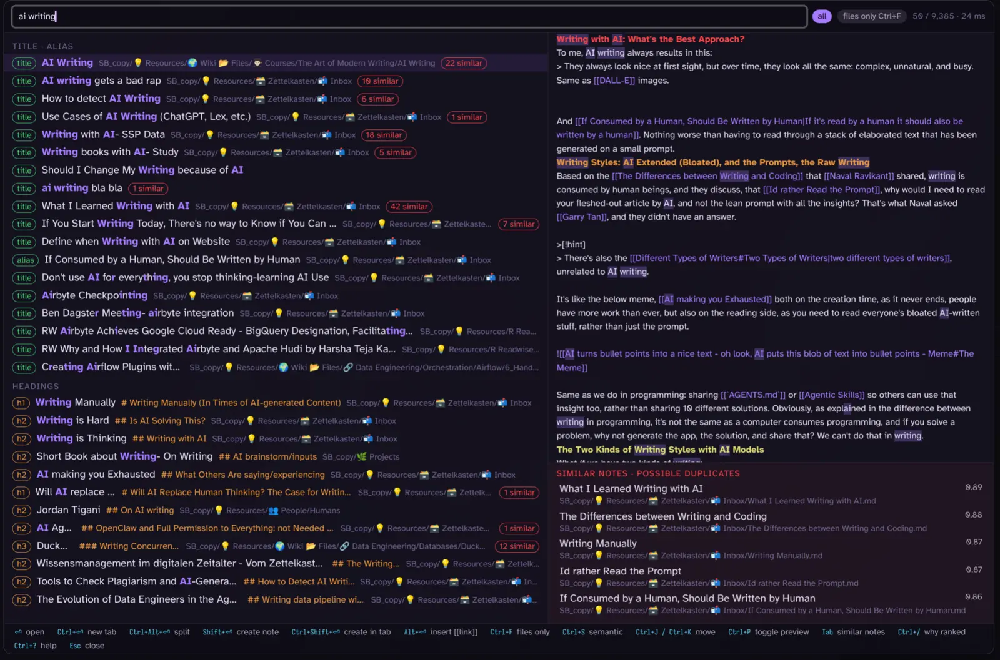
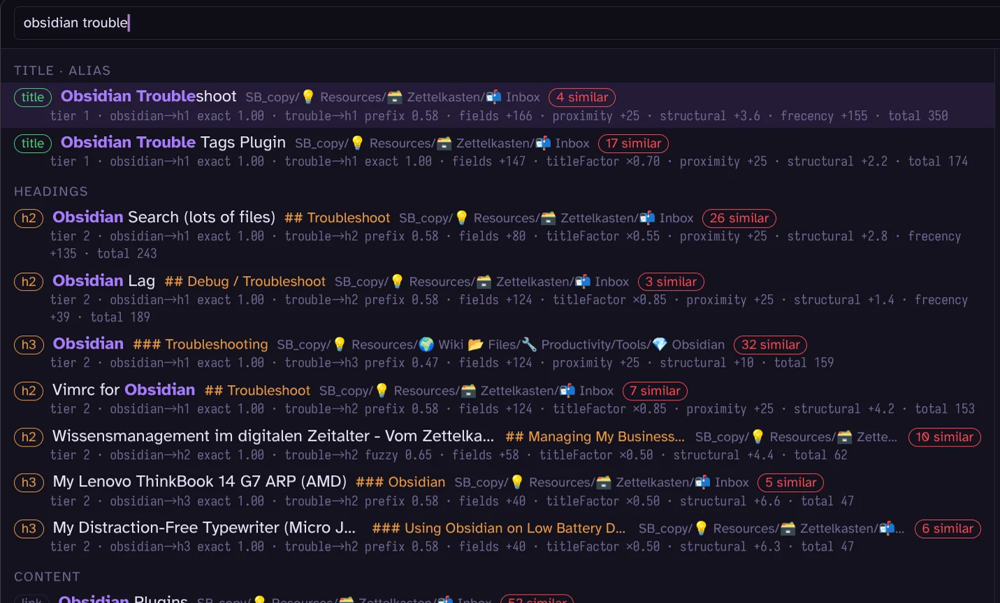

# Fast Find 10K

A fast note finder for large vaults (10k+ notes). A Rust search engine compiled to WebAssembly runs in a worker and powers instant fuzzy, field-weighted, frecency-ranked search with optional semantic "similar notes".

This is how it looks:


## Origin Story

I've built my dream search for [[Obsidian]] based on [[fzf]]/[Telescope](https://github.com/nvim-telescope/telescope.nvim) form Neovim for preview style and fuzzy search, Omnisearch for smarter search, and [[Obsidian Smart Connections|Smart Connections]] for similar notes, all based on Rust [[WebAssembly (WASM)|WASM]] to be super fast. This is how it looks:

I used Omnisearch for 5+ yearso, plus, and I ran into the 10k limitation of Obsidian. luckly Kepano, the CEO Obsidian [quickly solved](https://bsky.app/profile/stephango.com/post/3mvljvuhwks2p). The problem was that wikilinks starting with `[[` didn't show notes that existed in the vault. I knew it, sometimes they showed, sometimes they didn't, see the video [here]().

But I also noticed, that Omnisearch sometimes I missed notes, or I had to know the title exactly. It was not as much fuzzy finding as i wanted, plus the configration between searching the title of file (I used quick switcher for taht) or h1-h3 headers, or if inside the body, wasn't that clear. Although, to their credit, you can speicify the weight of each in the settings.

But I also started to use Smart Connection panel on the left, that helped me to find similar notes, as to make sure I don't create a note that already exists.

In this new plugin I created with Claude Code, i integrated Quick Seach, OMniseach and Smart Connections into one Plugin. If you have smart connections installed, we use the embeddings created for similary search. Plus the search is more fuzzy too, so if you type `toubleshoot`, missing the `r`, it will still find the troubleshoot note.

It will nicely show the different titles, and h1-3 and body, plus you can toggle why they were found.

And bottom right, there's similar notes to show and avoid creating an existing note twice, which is most important to [my obsidian workflow](https://www.ssp.sh/blog/obsidian-note-taking-workflow/), as i don't relay on folders, but all by seach. So if search does not work anymore, I will create 10 of the same notes over and over again, plus i might not find my notes, usually i remember when I create a note and want to find a spefific, but in case I forgot, then this plusign helps me too.

> NOTE "The name"
> The name comes from finding fast notes, which is the key of this plugin and the 10k is a hint to my personal limitation I got from 10k above. It's not meant to stay like this, or not usable below 10k, it will work peferctly fine too for low files, but that's the reason why I created it, and hence the name.

## Features

- **Fast on big vaults.** The index is a Rust engine compiled to WebAssembly, running in a Web Worker. On the 9,385-note / 27 MB test vault the finder is searchable about 0.3 s after Obsidian loads (fully indexed after 1.2–1.4 s), and a query takes 4–18 ms inside Obsidian (1–8 ms native). There is no input debounce: every keystroke is a query, and the screen is repainted in under 30 ms. Notes are cached in IndexedDB, so a reload re-indexes only what changed; an edit is picked up within half a second.
- **Accurate ranking in tiers.** A note that matches every word in its title or an alias always ranks above one that matches only in a heading, which ranks above body-only matches. Within a tier, field weights, prefix and typo quality, how many title words the query left unmatched, word proximity, backlinks and your own opening history (frecency) decide the order. See [How ranking works](#how-ranking-works).
- **Fuzzy, but guarded.** `troubelshoot` still finds "Obsidian Troubleshooting" (one typo for 6–9 letter words, two for 10+, and one typo in titles already at 5 letters: `Gitub` finds "GitHub"), while scattered subsequences are rejected, so `writing` does not match "Airbyte Checkpointing". Word order never matters: `ai writing` and `writing ai` return the same list.
- **Why ranked here (Ctrl+R).** Every row can show its tier, which field each word hit (exact, prefix or fuzzy, with the quality), and every score component. When a result surprises you, one key shows the reason:

  

  "Obsidian Troubleshoot" wins over "Obsidian Trouble Tags Plugin" although the latter matches `trouble` exactly: two of its title words were not in the query (`titleFactor ×0.70`), and the first note was opened before (`frecency +155`).
- **Similar notes, to avoid creating a note twice.** The panel bottom right lists near-duplicates of the selected result, and every row carries an `N similar` pill. Similarity comes from title overlap, plus [Smart Connections](#smart-connections) embeddings when that plugin is installed. Before creating a note with Shift+Enter, the create guard shows the closest existing notes first ("Already have?"). This is the feature that stops a vault with no folders from collecting "AI", "AI and Data Engineering" and "AI for Data Engineers" three times over.
- **Create when nothing exists.** Shift+Enter creates a note named after the query (Mod+Shift+Enter in a new tab). Unresolved `[[links]]` show as ghost rows (`[ghost x2]` = linked from two notes) and can be created the same way.
- **Files only (Ctrl+F)** switches to titles, aliases and paths, as a Quick Switcher replacement.
- **Telescope layout with preview.** Results left, the note preview right with the matches highlighted, vim keys to move (Ctrl+J/K) and to scroll the preview (Shift+J/K). Enter opens, Mod+Enter in a new tab, Mod+Alt+Enter in a split, Alt+Shift+Enter opens all shown results (10 or fewer).
- **Query syntax** for narrowing: `"exact phrase"`, `#tag`, `path:folder`, `-exclude`. Optional words (`a an the of to in on i` by default) never exclude a note, and abbreviations expand (`oss` → "open source"), both editable in the settings.
- **Respects your vault setup.** Obsidian's "Excluded files" are never indexed, you can add ignored globs, and folders such as an archive can be downranked instead of hidden.
- **Semantic results on demand (Ctrl+S)** through Smart Connections embeddings, as a separate tier below the text matches.
- **Resume and recall.** "Search (resume last)" reopens the finder with the previous query; notes you keep opening from the same query get a sticky bonus.
- **Local only.** No language model, no network. See [LLMs or AI](#llms-or-ai).
## Install

There is no release yet (a GitHub release with `main.js`, `manifest.json` and `styles.css` comes later). For development, build and symlink the plugin into a vault:

```sh
bash scripts/build-wasm.sh                  # needs the wasm32-unknown-unknown target and wasm-bindgen-cli 0.2.128
cd plugin && npm ci && npm run build        # dist/main.js (wasm and worker embedded), manifest.json, styles.css
V=<vault>/.obsidian/plugins/fast-find-10k
mkdir -p $V && ln -sf $PWD/dist/main.js $PWD/dist/manifest.json $PWD/dist/styles.css $V/
```

Then enable "Fast Find 10K" under Settings → Community plugins. Requires Obsidian 1.5.7 or newer.
[docs/dev-checklist.md](docs/dev-checklist.md) has the reload and verification steps.

## Usage

Commands (bind them to hotkeys in Settings → Hotkeys):

| Command | What it does |
|---|---|
| Search | opens the finder over titles, aliases, headings, tags, links, paths and content |
| Search file names | opens it in files-only mode (titles, aliases, paths) |
| Search (resume last) | reopens it with the last query |
| Rebuild index | drops the note cache and reads every file again |

Query syntax: plain words are AND-ed and match by prefix and with typo tolerance; `"exact phrase"`, `#tag`, `path:folder`, `-exclude`. A `#tag` no note carries, or a `-word` that would leave nothing, is searched as a plain word, so pasting a title such as `Newsletter #115` works. No input debounce: every keystroke is a query.

An empty query lists recently opened notes. Rows show which field matched (title, alias, heading, content, link) with highlights, a preview on the right, and an `N similar` pill when near-duplicates exist.

### Keys

Defaults (`Mod` is Cmd on macOS, Ctrl elsewhere); every binding can be changed in the settings, and Ctrl+? shows the current ones in the modal.

| Key | Action |
|---|---|
| ↓ / Ctrl+J | next result |
| ↑ / Ctrl+K | previous result |
| Shift+J / Shift+K | scroll the preview down / up. Search is case-insensitive, so typing lowercase j/k is the same query; only a note created with Shift+Enter would get a lowercase j/k in its name (rebind to Alt+J / Alt+K if that matters) |
| Tab | focus the similar-notes panel |
| Enter | open |
| Mod+Enter | open in a new tab |
| Mod+Alt+Enter | open in a split |
| Alt+Shift+Enter | open all shown results in tabs (10 or fewer) |
| Shift+Enter | create a note named after the query (with the "Already have?" guard) |
| Mod+Shift+Enter | create it in a new tab |
| Ctrl+F | toggle files only |
| Ctrl+S | add semantic results (Smart Connections) |
| Ctrl+P | toggle the preview |
| Ctrl+R | toggle "why ranked here" (tier, per-term field and match, score parts); while the search is open Ctrl+R does not reload Obsidian. A saved binding still on the old default Ctrl+/ moves to Ctrl+R on load (unless Ctrl+R is taken) |
| Ctrl+L | toggle language expansion for this search session (the German word list and the dictionary note join the abbreviations); off at startup unless "German words on at startup" is set. The header pill "+languages" shows the state |
| Ctrl+? (Ctrl+Shift+/) | toggle the key help |
| Esc | close (or leave the similar panel / help) |

### Settings

- **Indexing**: ignored folders/globs (never indexed; Obsidian "Excluded files" are always honoured), downranked folders (still searchable, score × 0.3), rebuild index.
- **Ranking**: field weights (title 100, alias 90, h1 60, h2 50, h3 40, tag 30, link 20, path 15, body 10; a weight of 0 turns the field off), fuzzy typo tolerance (off / normal / loose), partial-match tier (when few / always / never), optional words that a query never requires (default `a an the of to in on i`; they still add to the score where they match), abbreviations and synonyms (one group per line, `oss: open source, open-source software`; typing a single-word member also finds the other members, see [Examples](#examples)), German words on at startup (language expansion adds about 400 built-in English ↔ German word pairs and the dictionary note to the abbreviations: `school` finds "Schule Madretsch", `Kinder` finds "children"; off by default, Ctrl+L switches it per session), dictionary note (the path of a note in the vault whose `english: german, german` lines join the abbreviations, reloaded when you edit it).
- **Semantic**: use Smart Connections embeddings, minimum similarity shown, semantic tier (auto / on demand / never).
- **Behaviour**: create guard, preview open by default.
- **Keys**: every modal binding.
- **Debug**: "why ranked" by default, log engine timings to the console, clear frecency.

## How ranking works

Each query word (and each quoted phrase) must match, except optional words (`a an the of to in on i` by default), which only add to the score. A note's **tier** comes from the weakest field its words matched, and a lower tier never ranks above a higher one:

1. **title · alias**: every word in the title or an alias (unresolved link targets, "ghosts", also appear here and can be created with Shift+Enter). A ghost is hidden when a note of that name exists, compared with diacritics and emoji folded: `[[Café]]` does not show as a ghost when `Cafe.md` exists
2. **headings**: every word in a title, alias or H1–H3
3. **content**: every word somewhere, including body, tags, links and path
4. **partial**: some words missing but one in the title or an alias (shown when the other tiers have few hits)
5. **semantic**: Smart Connections neighbours of the query, when enabled

Within a tier the score adds the field weights × match quality (exact 1.0, prefix by length ratio, fuzzy below that), shrinks it for title words the query left unmatched, and adds proximity (words close together or in one section), backlinks, a bonus when the title is exactly the query's words, frecency (opens over the last 30 days, decaying) and a sticky bonus for a note opened three times from the same query. Downranked folders and very short notes are multiplied down. Ctrl+R shows every part for each row.

### Smart Connections

When [Smart Connections](https://github.com/brianpetro/obsidian-smart-connections) (4.7.2) is installed and has embedded the vault, Fast Find 10K reads its note vectors (read-only, through one bridge module) and uses them for the semantic tier, the similar-notes panel and the create guard. Without it everything else works and the similar panel uses title similarity only.

### Examples

All results below come from the CLI on the 9,385-note test vault (`ff10k query <vault> "<q>"`), which is a copy of my own vault; Obsidian shows the same list.

**Word order does not matter.** `ai writing` and `writing ai` give the same list:

```
1  AI Writing
1  How to detect AI Writing
1  Use Cases of AI Writing (ChatGPT, Lex, etc.)
1  Writing with AI- SSP Data
```

**Typos.** `obsidian troubelshoot` (letters swapped) still puts "Obsidian Troubleshoot" first; the rest are notes with a troubleshooting heading:

```
1  Obsidian Troubleshoot
2  Obsidian                          ### Troubleshooting
2  Vimrc for Obsidian                ## Troubleshoot
2  Obsidian Lag                      ## Debug / Troubleshoot
```

**Fully covered titles win.** `obsidian trouble` ranks "Obsidian Troubleshoot" above "Obsidian Trouble Tags Plugin", because the second title has two words the query did not mention. Ctrl+R shows it: `trouble→title prefix 0.58 · titleFactor ×1.00` versus `trouble→title exact 1.00 · titleFactor ×0.70`. Type `trouble tags` and the plugin note comes first.

**Phrase, tag, path and exclude.** `"data engineering" duckdb` needs the two words next to each other and `duckdb` anywhere:

```
1  Reducing complex Data Engineering Architecture with SQLite and DuckDB
1  What has WebAssembly (WASM) to do with DuckDB and data engineering   [ghost x1]
2  Data Engineering Whitepapers       ## DuckDB
```

The second row is a ghost: a `[[link]]` to a note that does not exist yet. Shift+Enter creates it. `path:inbox dagster -airflow` limits the path to `inbox`, requires `dagster` and drops every note that mentions Airflow.

**Optional words.** `should i change` finds "Should I Change My Writing because of AI" first, and a note titled "Change Should Happen" also qualifies for the title tier although it has no `i`, because `i` is on the optional list. Where an optional word does hit, it still adds to the score.

**Abbreviations.** With the setting line `oss: open source, open-source software`, the query `oss` matches notes that say OSS, "open source" or "open-source software" in the title, headings or body:

```
without the group                        with the group
1  Open Source (alias OSS)               1  Open Source
1  dbt (alias)                           1  Supporting Open Source
1  OSS git Analytics and insights        1  Why Open-Source
1  Podcast Bedag - OSS Data Engineering  1  dbt (alias)
                                         1  open-source lock-in
                                         1  The Death of Open Source
```

**German words.** With language expansion on (Ctrl+L in the search, or the "German words on at startup" setting), `school` also finds "Empfangsstruktur (Schule Madretsch)" and "Schulen im Kanton" (prefix: `schule` → `Schulen`, umlauts folded), and `schule` finds the English "School Notes". The list is about 400 everyday pairs (`crates/ff10k-core/dict/de.txt`); add your own in the abbreviations box, or keep them in a note (`Dictionary.md` with lines such as `invoice: rechnung, faktura`) and name it in the "Dictionary note" setting. Everything stays exact or prefix: no translation model, and nothing changes while the toggle is off.

Why not a full dictionary: I tried the free [Ding](https://dict.zero-g.net/) German–English dictionary (414k entries, GPL). Every automatic reduction expands a word to all its senses: `note` becomes Banknote and Hauch, `change` becomes Kleingeld and Münzen, `house` becomes Geschlecht, and the strict rules that remove those also remove `Kind` and `Daten`. A query expansion needs the one everyday translation, which a general dictionary does not mark, so the built-in list is hand-picked and the dictionary note is yours.

The same for `de: data engineering`: alone, `de` is an exact two-letter word and finds "TJ DeVries" and "Elias DeFaria"; with the group it finds the "Data Engineering" hub notes first. Typing a single-word member finds the others in both directions (`k8s: kubernetes` makes `kubernetes` find the "K8s Cheatsheet" note too); a several-word member is only found, so `open source` does not search for `oss`.

**Files only.** Ctrl+F with `obsidian lag` lists "Obsidian Lag" and then partial title matches ("Obsidian", "Using Obsidian with AI"); headings and body are not searched.

**Similar notes.** Selecting "How to detect AI Writing" shows, from the Smart Connections embeddings:

```
0.850  AI Writing
0.838  What I Learned Writing with AI
0.836  Originality.ai (detecting AI generated articles)
0.830  Tools to Check Plagiarism and AI-Generated
```

Without Smart Connections the panel uses title overlap only: "👉🏻 Data Engineering" lists "AI in Data Engineering", "Airflow for Data Engineering", "Data Engineering Glossary" and so on.

### Compared with Omnisearch

Same vault, same queries, Omnisearch 1.31.0 with its default fuzziness. First three results each:

| Query | Fast Find 10K | Omnisearch |
|---|---|---|
| `obsidian trouble` | Obsidian Troubleshoot · Obsidian Trouble Tags Plugin · Obsidian (### Troubleshooting) | Obsidian Trouble Tags Plugin · Obsidian Troubleshoot · Vimrc for Obsidian |
| `obsidian troubelshoot` | Obsidian Troubleshoot · Obsidian (### Troubleshooting) · Vimrc for Obsidian | no results |
| `oss` | Open Source (alias OSS) · dbt (alias) · OSS git Analytics and insights | OSS git Analytics and insights · Open Source · Podcast Bedag - OSS Data Engineering |

Recall over the vault's own titles (every note queried by its full title, its first two words, and its title with one letter deleted; the note must be the first hit), a 939-note sample (every 10th note) for both tools. No language expansion or abbreviations were active in any run:

| Query | Fast Find 10K (after the recall fixes) | Fast Find 10K (before) | Omnisearch |
|---|---|---|---|
| full title | 99.3 % first, 100 % in top 5 | 97.3 % first, 99.7 % in top 5 | 97.8 % first, 100 % in top 5 |
| first two words | 60.8 % first, 82.0 % in top 5 | 56.5 % first, 80.8 % in top 5 | 71.5 % first, 87.4 % in top 5 |
| one letter deleted | 98.6 % first, 100 % in top 5 | 91.6 % first, 94.6 % in top 5 | 78.2 % first, 83.8 % in top 5 |

The first run found the misses that led to four ranking fixes (all with goldens); the "after" column is the same procedure afterwards. Over all 9,385 notes Fast Find 10K now finds 98.9 % by full title as the first hit (99.97 % in the top 5) and 97.9 % with one letter deleted (99.8 % in the top 5); every miss, its cause and the fix are in [docs/recall.md](docs/recall.md). Run `ff10k recall <vault>` to get the numbers for your own vault.

The "first two words" row is expected, not a gap: a query such as `RW Data` matches about a hundred notes titled "RW Data …" equally (every word matched, same number of unmatched title words), so which equal note comes first is a tie-break. Fast Find 10K breaks ties by backlinks, then by modification date; Omnisearch's BM25 prefers the shorter document, which happens to agree with the test more often. The note you want is in the top 10 in 88 % of these ambiguous queries, and typing one more word resolves it.


### LLMs or AI
Everything here shown is based locally, no AI model used, no local and also no frontier or online model. Smart Connection creates local embeddings in `.smart-env` (small local embedding model), and these we use for showing similar notes. Everything else is just local index based on your notes.
 
Everything runs locally and there is no language model involved. Search is a plain index over your notes: tokens, fields, positions, frecency. No model runs when you type. The one exception is similar notes: if you have Smart Connections installed, FF10K reuses the embeddings it already stored in `.smart-env`. Those come from a small local embedding model (a few hundred MB, not an LLM), and FF10K does not compute them, but instead read and compresses them from Smart Connctions. If Smart Connections isn't installed, nothing changes except the similar-notes panel falls back to title overlap only.

## Performance

On a 9,385-note / 27 MB vault: warm start about 1.2–1.4 s to fully indexed (searchable after the first 500 notes), engine time per query 4–18 ms in Obsidian, 1–8 ms native. Numbers and method in [docs/perf.md](docs/perf.md).

## Development

- Build: `cargo build --release` (CLI binary: `target/release/ff10k`)
- Test: `cargo test --workspace`; plugin: `cd plugin && npm test`
- Golden: `cargo test -p ff10k-core --features golden --test golden`, or `ff10k golden <vault> <golden.toml>` (exit 1 on failures)
- Typo recall: `cargo test -p ff10k-core --features golden --test typo_recall -- --nocapture` (one typo in a title word must keep the note in tier 1)
- Recall on your own vault: `ff10k recall <vault> [--every 10] [--all-misses]` queries every note by its full title, its first two words and its title with one letter deleted, and prints how often the note is the first hit, in the top 5 and in the top 10, with every miss (`--sample-out file.json` writes the queries for running the same set through another search plugin)
- Benches: `cargo bench -p ff10k-core` (criterion), `ff10k bench <vault>` (p50/p95 in microseconds, 200 runs per query), `ff10k profile <vault>` (ingest time per phase, engine heap)

### CLI (`ff10k`)

```sh
ff10k index   <vault>                                   # docs, bytes, index time, RSS
ff10k query   <vault> "<q>" [--files] [--debug] [--limit N] [--smart-env] [--synonym "oss: open source"]...
ff10k similar <vault> <vault-relative-path> [--smart-env]
ff10k golden  <vault> <golden.toml>
ff10k bench   <vault>
ff10k profile <vault>                                   # read / extract / tokenize / insert / keys split, heap
ff10k recall  <vault> [--every K] [--sample-out f.json] [--all-misses]   # title / two-word / one-typo recall @1 @5 @10
```

The vault walk skips dot-folders and non-`.md` files and honours Obsidian "Excluded files"
(`userIgnoreFilters` in `.obsidian/app.json`: `/regex/` entries or path prefixes).
`--smart-env` loads Smart Connections embeddings from `<vault>/.smart-env`.

## Credits

Ideas and behaviour borrowed from [fff](https://github.com/dmtrKovalenko/fff.nvim), [fzf](https://github.com/junegunn/fzf), [Telescope](https://github.com/nvim-telescope/telescope.nvim), [Omnisearch](https://github.com/scambier/obsidian-omnisearch) and [Smart Connections](https://github.com/brianpetro/obsidian-smart-connections). Fuzzy matching by [neo_frizbee](https://crates.io/crates/neo_frizbee).


*See also my other plugins I made, [Obsidian Trouble Tags](https://github.com/sspaeti/obsidian-trouble-tags).*
