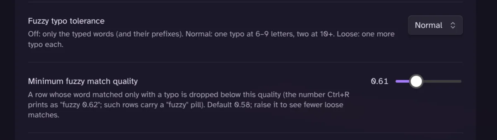
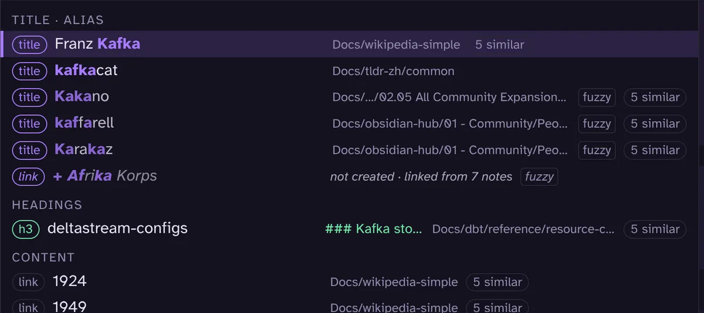

## What has changed?

A release about typo matches. Rows that reached a note only through a typo now carry a `fuzzy` pill and sort after the exact and prefix hits of their tier, so the rows holding the word you typed stand out. A new slider sets how loose such a match may be, and a typo can no longer stitch letters from two neighbouring words together, so `strasse` stops finding "Star system".

**Highlights**

- **Fuzzy rows are marked and sort last in their tier.** A row where some typed word matched only with a typo shows a square `fuzzy` pill (the round one still counts similar notes) and a slightly dimmed title. Within a tier, notes whose every word matched exactly or by prefix come first; `kafka` lists "Franz Kafka" and "kafkacat" before "Kakano" or "kaffarell". Hovering the row says why, and `Ctrl+R` prints the match quality as `fuzzy 0.62`.
- **A floor for fuzzy matches.** The new "Minimum fuzzy match quality" slider under Settings → Ranking (0.5 to 0.9, default 0.58) drops fuzzy rows below that quality. Raise it to see fewer loose matches; the number is the same one `Ctrl+R` shows, so you can read the value off a row you do not want and set the slider just above it. "Fuzzy typo tolerance" above it now explains its three levels.

  

  
- **A typo never spans words.** A one-typo alignment must stay inside one word of the title, heading or body. Only a dropped space may cross a word boundary, and then every typed letter has to match: `database` still finds "Data Base Design" as a title hit.

**Fixes**

- `strasse` surfaced "Star system", because the matcher accepted `str` from the first word plus `sse` from the second with the missing `a` as its one allowed typo. Such cross-word alignments are rejected now, and the query lands on "Søren Kierkegaard" through its folded `Straße` heading as before.

How the tiers, the fuzzy guards and the score parts fit together is described in the README under "How ranking works".
