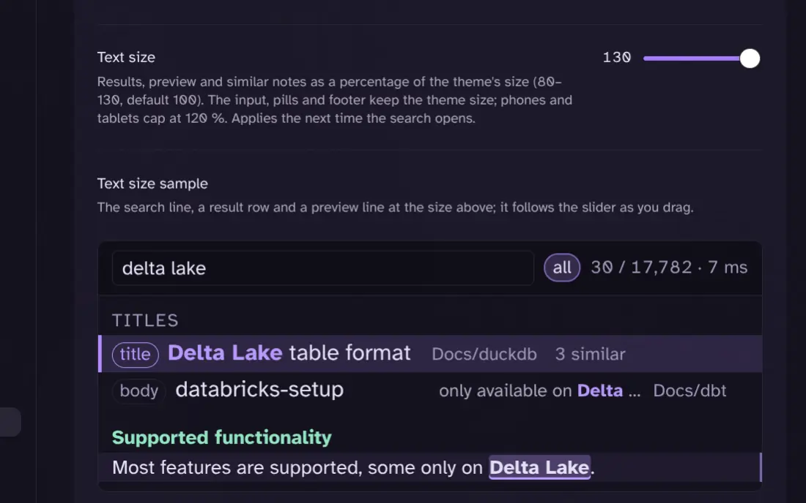

## What has changed?

A small release with one new setting: you can now make the search text larger or smaller than your theme's size. Results, preview, similar notes and the search bar all follow it, so a dense list on a big screen or a cramped one on a phone is a slider away.

**Highlights**

- **Text size setting.** Settings → Behaviour → `Text size` scales the result rows, the preview, the similar-notes panel and the search bar (input, pills, count) from 80 % to 130 % of the theme's size. The footer hints and the help overlay keep the theme size, so the modal's frame never grows with the text.
- **Live sample and instant apply.** A sample under the slider, built from the same search line, tier label, result rows and preview lines the modal uses, follows the slider as you drag. If a search is open while you move it, the open search resizes too.
- **Phones cap at 120 %.** On mobile the slider still goes to 130 but the applied size stops at 120 %, so a single-column layout stays usable.

**Fixes**

- No user-facing bugs were fixed in this release. Search, ranking and keys are unchanged from 0.2.5.

Install from the release assets or build with `make build` as described in the README.
