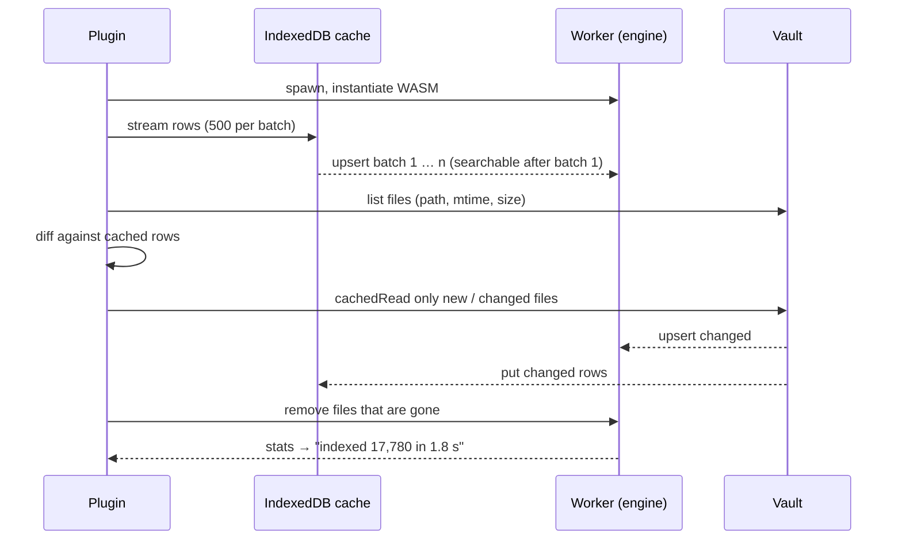
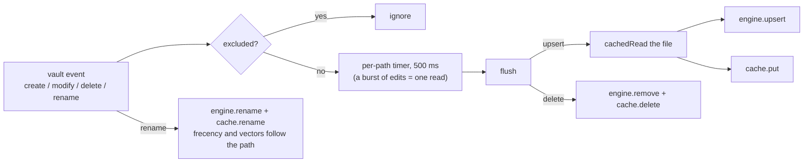
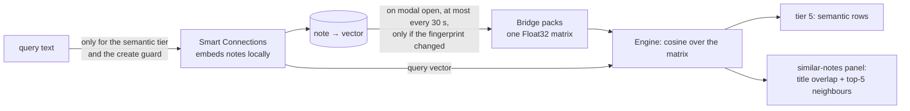

# How Fast Find 10K works

A short tour for people who want to know why the index builds in seconds, why every keystroke
answers in milliseconds without getting the ranking wrong, how the index survives a restart,
how edits reach it, and where Smart Connections comes in. The binding details are in the
[design spec](superpowers/specs/2026-10-26-fast-find-10k-design.md).

## The shape

Two halves, one message channel. The Obsidian side (TypeScript) talks to the vault and draws
the UI. The engine (Rust, compiled to WebAssembly) runs in a Web Worker and never touches
Obsidian; it only sees text and queries. The main thread never indexes and never ranks, so the
editor never freezes, however large the vault.

```mermaid
flowchart LR
  subgraph Obsidian["Obsidian renderer (TypeScript)"]
    V[(Vault files)]
    IX[Indexer]
    C[(IndexedDB cache<br/>path → raw text)]
    UI[Modal: results, preview,<br/>similar notes]
    SC[Smart Connections bridge]
  end
  subgraph Worker["Web Worker"]
    E[Rust engine (WASM)<br/>inverted index per field,<br/>fuzzy matcher, tiered ranking,<br/>vector matrix]
  end
  V -- vault events, cachedRead --> IX
  IX -- rows --> C
  C -- warm start --> IX
  IX -- upsert / remove / rename --> E
  UI -- search, similar, docText --> E
  E -- hits with tier, badge, excerpt --> UI
  SC -- Float32 matrix of note vectors --> E
```

The engine is one 1 MB `.wasm` embedded in `main.js`; nothing is downloaded and nothing runs
outside Obsidian. The same Rust crate also builds a command-line tool, which is how ranking is
tuned and tested against a folder of notes without opening Obsidian.

## Why indexing is fast

Three reasons, in order of weight.

**The slow part is reading files, so it is done once.** Reading 10k notes through the vault API
takes seconds; turning 30 MB of text into an index in Rust takes well under a second. The
plugin therefore caches the *raw text* of every note in IndexedDB (database `ff10k/<vault>`,
one row per path: `path, mtime, size, text`) and rebuilds the index from that cache on every
start. The built index is deliberately not persisted: it would be a large binary blob to keep
in sync, and rebuilding it is cheaper than loading it.

**Extraction is one pass in Rust.** The engine parses frontmatter, headings, tags, links and
properties itself from the raw text, tokenizes each field once, and inserts the terms into one
inverted index per field (title, aliases, H1, H2, H3, tags, links, path, properties, body). No
JSON in between, no round trips to Obsidian's metadata cache. A canvas is converted to a small
markdown note on the way in; an Excalidraw file has its drawing blob skipped.

**Work is streamed, and search starts early.** The cache is streamed to the worker in batches
of 500 rows; the engine is searchable after the first batch, and the modal shows
"indexing 3,120 / 17,780" until the run is complete.



A full rebuild (`Rebuild index`) drops the cache and reads every file; on a desktop that is a
few seconds for 17k notes because the read is parallel in batches of 200 and the engine keeps
up. A warm start on the same vault is about two seconds, most of it streaming rows out of
IndexedDB.

## Why search feels instant and still ranks right

**No debounce; stale work is dropped.** Every keystroke posts a query with an increasing id.
The worker processes messages in order on one promise chain; if a newer query has arrived by
the time an older one would run, the older one is answered as stale without running. The UI
ignores any reply that is not for the latest id. Typing fast costs nothing extra.

**Exact and prefix matches are index lookups.** Each field's term dictionary is sorted, so a
prefix is a range scan and an exact word is one lookup; the posting lists carry positions for
proximity and highlighting. Fuzzy matching (the `frizbee` Smith-Waterman matcher with a typo
budget) is only run over the title, alias and heading strings, and only for notes that got no
exact or prefix hit there. That is the trick: fuzzy over 17k short strings is cheap; fuzzy over
30 MB of body text is not, and is not done.

**Candidates first, details later.** Ranking runs over candidate doc ids and computes only the
tier and score. Excerpts, highlight ranges, heading text and "why ranked" components are
derived afterwards for the returned page only (30 rows), not for every candidate.

**Ranking is rules, not a single score.** Every query word (and every quoted phrase) must
match. A note's *tier* is the weakest field its words hit: all in title or alias → 1, all in
title/headings → 2, somewhere → 3; a note missing a word but hitting another in its title is
partial → 4; Smart Connections neighbours are 5. A lower tier never ranks above a higher one,
whatever the scores say. Within a tier the score adds field weights × match quality (exact,
prefix, or fuzzy quality), a factor that shrinks for every title word the query left unmatched,
proximity, backlinks, frecency (how often and how recently you opened the note), and the
query→note combination you chose before. `Ctrl+R` shows all of it per row.

**Lazy caches, warmed when idle.** Two caches are expensive to rebuild after an edit (the fuzzy
string list and backlink counts, tens of milliseconds on 10k notes). The worker clears them on
every index mutation and rebuilds them once it has been idle for 100 ms, so the next keystroke
does not pay for them.

Measured on a 9,385-note vault: 4–18 ms engine time per query in Obsidian, 1–8 ms native
(`docs/perf.md`). The number next to the result count in the modal is the engine time of the
query you just typed.

## How edits reach the index

The plugin listens to Obsidian's vault events instead of watching the filesystem.



- Events are coalesced per path: while you type in a note, the modify events reset a 500 ms
  timer, and the note is re-read once after you pause. No "wait for window blur".
- A read is dropped if the file changed again meanwhile or another event for that path is
  pending; the newer flush owns the path.
- A rename is a key change in the engine and the cache, so frecency and the Smart Connections
  vector stay attached to the note.
- Obsidian's "Excluded files" and the plugin's own ignore globs are applied at the event, so an
  excluded note never enters the engine. Unresolved links (`[[Not yet written]]`) are not
  cached; they come from Obsidian's metadata cache and are sent as "ghost" docs so they appear
  in the title tier and can be created with Shift+Enter.

The cache has a schema version; on mismatch (or a corrupt database) it is dropped and rebuilt
from the files. If IndexedDB cannot be opened at all, the plugin runs without a cache: slower
start, same search.

## Smart Connections: borrowed vectors, no second embedding run

Fast Find 10K never computes embeddings. If Smart Connections is installed, one bridge module
reads the vectors it already produced (`window.smart_env.smart_sources`, one 384-dimensional
`Float32Array` per note) and copies them into a single contiguous matrix that is transferred to
the worker. The engine keeps that matrix next to the index, keyed by path.



- The matrix is refreshed when the modal opens, at most once per 30 s, and only when the item
  count or a content hash changed (a fingerprint pass over the items, not a copy).
- Lexical search never embeds anything. The query is embedded only for the semantic tier and
  for the "already have a note like this?" guard before creating a note; a slow or stalled model
  (over 1.5 s) counts as no vector.
- Cosine similarity is a dot product in Rust over normalized vectors. The same matrix feeds two
  things with two thresholds: the similar-notes panel (note-to-note, floor 0.70 by default) and
  the semantic tier (query-to-note, which scores lower, floor 0.60).
- Everything works identically without Smart Connections: the semantic tier is simply absent
  and the similar panel falls back to title overlap (reordered words, copy suffixes, same title
  in another folder).

## Where things live

| Part | Path | Role |
|---|---|---|
| Engine | `crates/ff10k-core` | extraction, index, matcher, ranking, similar, vectors; all tests |
| WASM wrapper | `crates/ff10k-wasm` | JSON-string API over the engine |
| CLI | `crates/ff10k-cli` | index / query / golden / bench / recall on a folder |
| Worker | `plugin/src/worker.ts` | owns the engine, serializes requests, drops stale searches |
| Indexer | `plugin/src/indexer.ts` | warm start, vault diff, event coalescing |
| Cache | `plugin/src/cache.ts` | IndexedDB rows, frecency, query→note combos |
| Bridge | `plugin/src/smart-connections-bridge.ts` | the only code that touches Smart Connections |
| UI | `plugin/src/ui/` | modal, results, preview, similar panel, help |
