# Comparison: native search, Omnisearch, Fast Find 10K, QMD

Same vault, same queries, same machine, screenshots taken the same morning. The point is not
that one tool wins. Each answers a different question, and the conclusion at the end says which
to reach for at which vault size.

## Setup

| | |
|---|---|
| Vault | the plugin's test vault: 17,780 indexed files (6,566 Obsidian Hub pages, 6,000 Simple-Wikipedia articles, 1,723 Kubernetes docs, 1,171 dbt docs, 463 DuckDB docs, the NKJV Bible as 1,255 chapter notes, 49 coffee notes with properties, a few canvases, bases and drawings) |
| Obsidian | 1.15.0, desktop, Linux |
| Native search | the core *Search* plugin, default sort "File name (A to Z)" |
| Omnisearch | 1.32.0, default settings |
| Fast Find 10K | 0.2.2, default settings, abbreviation group `oss: open source, open-source software`, Smart Connections 4.7.2 vectors present |
| QMD | 2.8.3, `qmd collection add <vault>` then `qmd embed`; CPU only (24 cores, no GPU) |

Timings are what each tool reports or what a stopwatch around its API measured; they are rough
and single-run. Native search streams results and keeps counting for a while, so its number is
the time until the count stopped changing.

## Queries

### `delta lake`: a two-word topic query

| Tool | Result | Time |
|---|---|---|
| Native | 897 matches, listed by file name: *1973*, *1986*, *2008*, *adapter-creation*, *August 25* (Wikipedia years with "Veronica Lake" and "Delta Dawn") | 0.4 s |
| Omnisearch | *delta*, *databricks-setup*, *lakehouse_formats*, *fabricspark-setup*, *azure* | 12 ms |
| Fast Find 10K | **headings**: *databricks-setup* (`### Delta Lake`); **content**: *delta*, *lakehouse_formats*, *azure*, *fabricspark-setup* | 8 ms |
| QMD (BM25) | *DuckDB Lakehouse Support Matrix* 95 %, *glue-setup* 94 % | 130 ms |

Native search finds every occurrence but ranks nothing: the order is alphabetical. Omnisearch
and Fast Find agree on the notes; Fast Find puts the note whose heading *is* "Delta Lake" first
and labels why.

| Native | Omnisearch | Fast Find 10K |
|---|---|---|
| 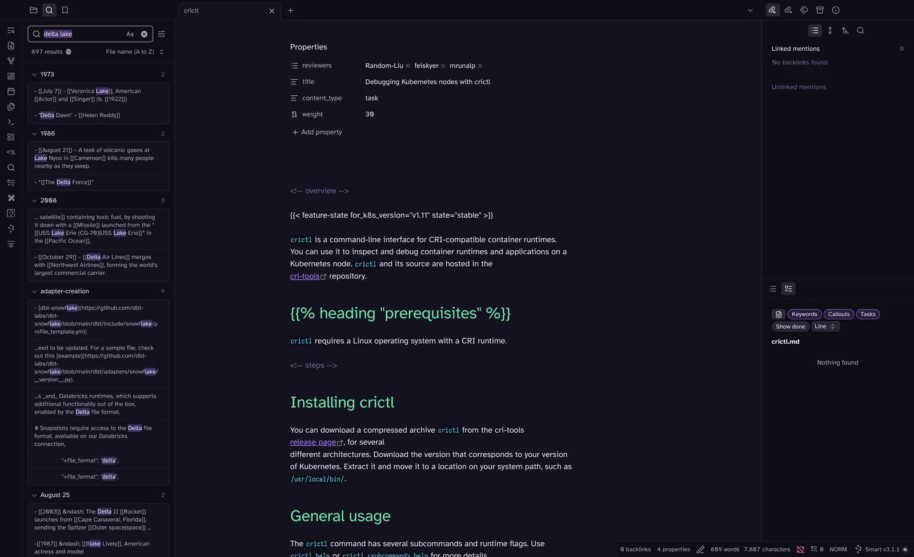 | 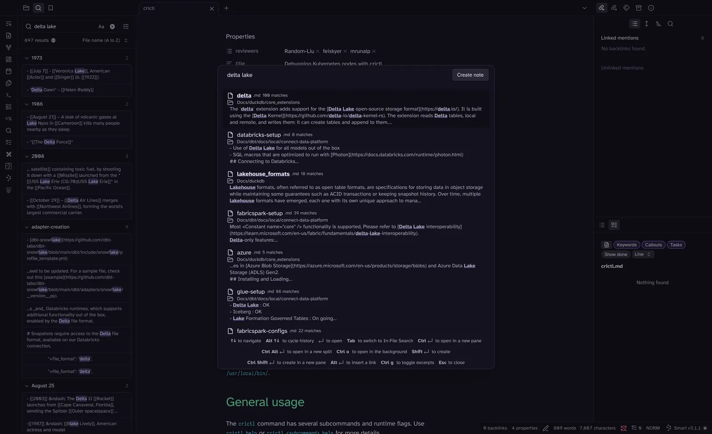 | 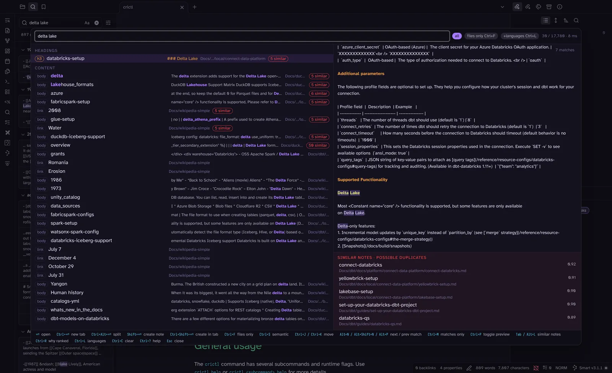 |

### `kubernets deploymnet`: two typos

| Tool | Result | Time |
|---|---|---|
| Native | 0 results | 0.2 s |
| Omnisearch | 0 results | 11 ms |
| Fast Find 10K | *\_index* (alias "Installing Kubernetes with deployment tools"), `## Deployment tools`, `## Kubernetes Deployments`, … then the semantic tier (*kubeadm*, *declare-network-policy*) | 18 ms |
| QMD (BM25) | no results | 115 ms |

Fast Find allows one typo per word of 6–9 letters (two at 10+), which is what makes a
10k-note vault forgiving when you half-remember a title. Omnisearch is fuzzy on prefixes, not
inside words.

| Native | Omnisearch | Fast Find 10K |
|---|---|---|
| 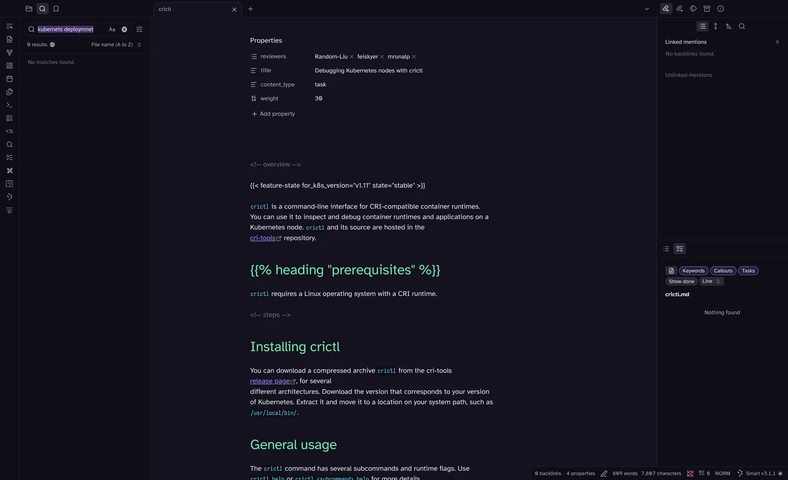 | 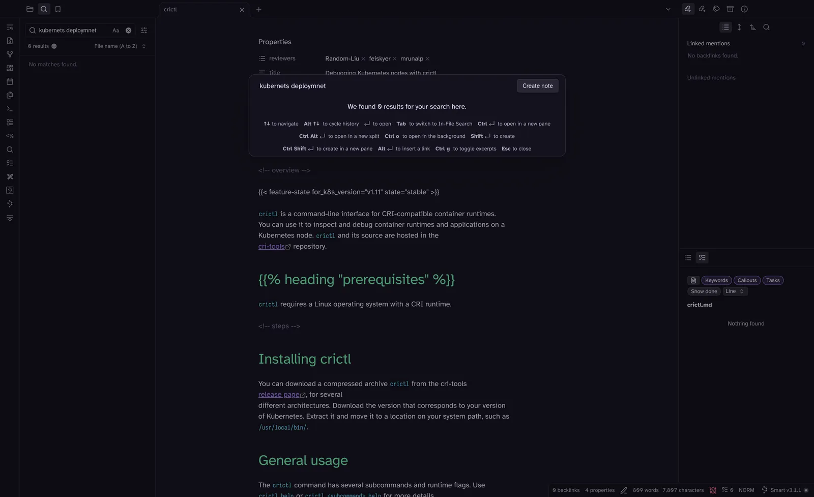 | 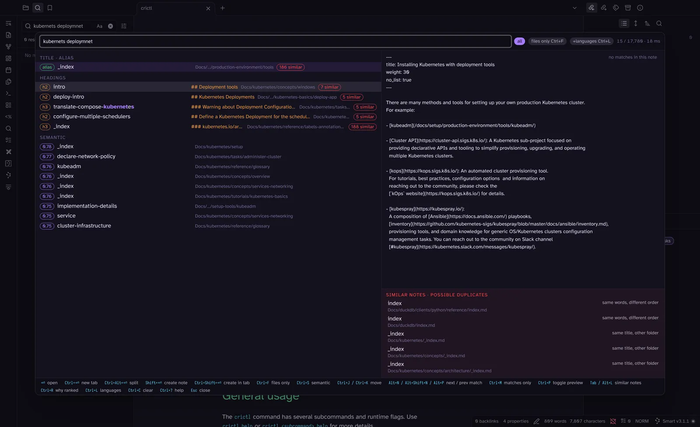 |

### `oss`: an abbreviation

| Tool | Result | Time |
|---|---|---|
| Native | 10,646 matches ("cross", "boss", "loss" …), by file name | 2.5 s |
| Omnisearch | *ossie-semantic-models*, *oss-sa-projects*, *install-dbt-2-oss*, *compatible-track-changelog*, *sl-manifest* | 34 ms |
| Fast Find 10K | *Open source*, *Open Source Initiative*, *Free and open-source software* (via the word list, marked), *oss-sa-projects*, *install-dbt-2-oss* | 13 ms |
| QMD (BM25) | *Install dbt OSS* 92 %, *osi-paths* 91 % | 120 ms |

Short tokens are where substring search hurts most. Fast Find treats three-letter words as
exact and expands the abbreviation group you configured; the expanded hits carry a "via word
list" badge so you know why they are there.

| Native | Omnisearch | Fast Find 10K |
|---|---|---|
| 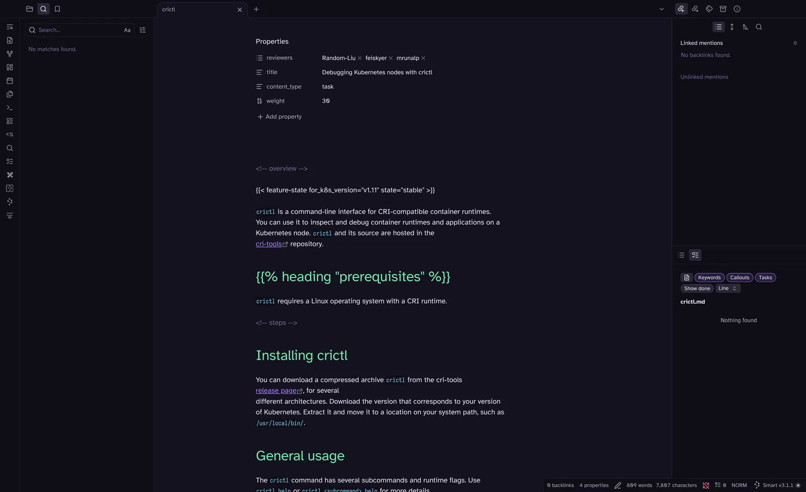 | 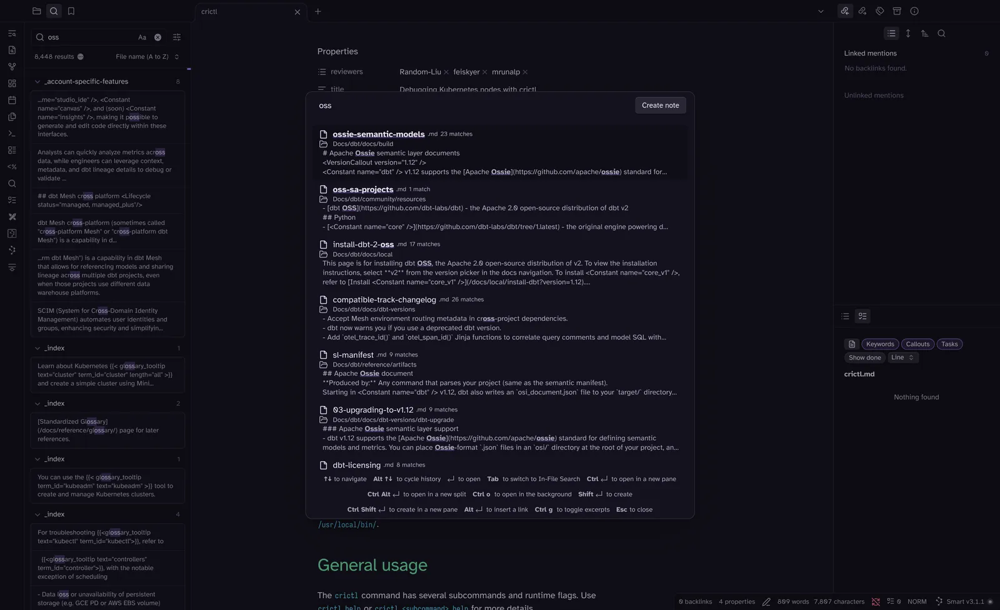 | 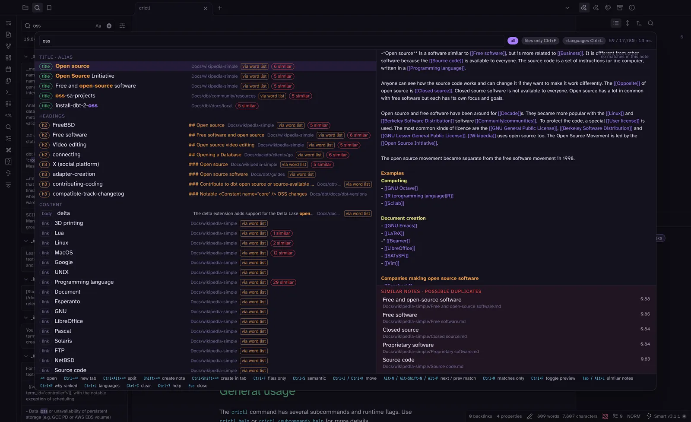 |

### `#publish`: a tag

| Tool | Result | Time |
|---|---|---|
| Native (`tag:#publish`) | 42 results, by file name | 0.2 s |
| Omnisearch | 50 results, tagged notes mixed with notes that merely contain the word "publish" (*Obsidian2Mkdocs* first) | 51 ms |
| Fast Find 10K | the tagged notes, most-opened first | 17 ms |
| QMD (BM25) | *Academic publishers*, *Publish sites*, *Orion Publish*: no tag syntax, the `#` is dropped | 300 ms |

### `[herkunftsland:india]`: a frontmatter property

| Tool | Result | Time |
|---|---|---|
| Native (`["Herkunftsland":India]`) | *KAFOJ Espresso*, *Ristretto* | 0.3 s |
| Omnisearch (`herkunftsland india`) | *KAFOJ Espresso*, *Ristretto* (as words, no property syntax) | 7 ms |
| Fast Find 10K | *KAFOJ Espresso*, *Ristretto* | 16 ms |
| QMD | no results (metadata is exposed to agents through its MCP `metadata` tool, not in the search syntax) | 170 ms |

Native and Fast Find both have a property filter; native's syntax needs quotes and exact
case, Fast Find's is case- and accent-insensitive and shows the value as context.

### `chocolatey espresso`: a query that needs meaning

Nothing in the vault contains "chocolatey".

| Tool | Result | Time |
|---|---|---|
| Native | 0 results | 0.2 s |
| Omnisearch | 0 results | 10 ms |
| Fast Find 10K | **partial**: every espresso note; then **semantic** (Smart Connections vectors): *Ethiopia* 0.65, *Colombia* 0.65, *Adriano Decaf* 0.64, the coffee notes whose tasting notes say chocolate | 75 ms |
| QMD (BM25) | no results | 190 ms |
| QMD (`vsearch`, embeddings) | see below | |

| Native | Omnisearch | Fast Find 10K (scrolled to the semantic group) |
|---|---|---|
| 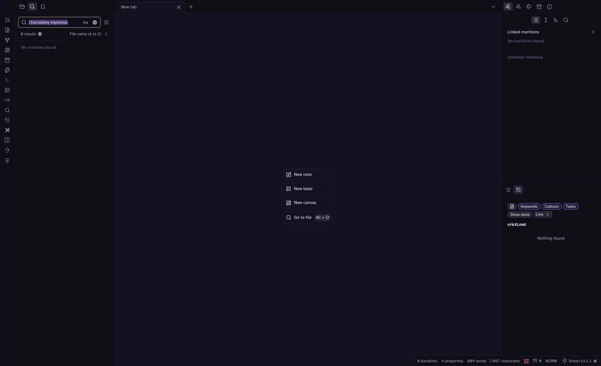 | 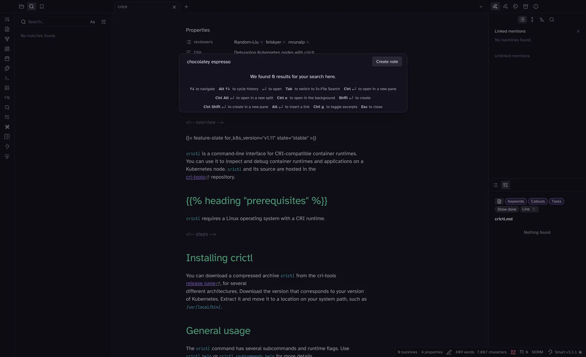 | 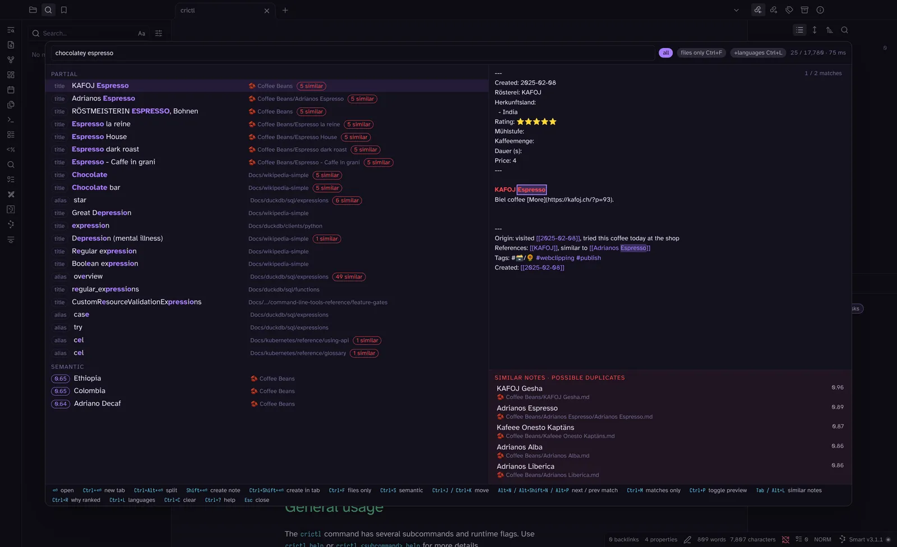 |

### `how to connect dbt to databricks`: a question

| Tool | Result | Time |
|---|---|---|
| Native | 17,581 matches (every note with "how", "to", "connect" …), by file name | 1.2 s |
| Omnisearch | *databricks-setup*, *set-up-your-databricks-dbt-project*, *connect-databricks*, *databricks-qs*, *set-up-databricks-oauth* | 127 ms |
| Fast Find 10K | *databricks-setup*, *connect-databricks*, *databricks-qs*, *get-started-dbt*, *prompt-cookbook* | 70 ms |
| QMD (BM25) | *Connect Databricks* 96 %, *migrate-from-spark-to-databricks* 96 % | 145 ms |
| QMD (`query`, hybrid + rerank) | see below | |

Stop words carry the native search away; the three ranked tools agree. This is QMD's home
ground once embeddings exist: it rewrites the question, searches words and vectors, and has a
model re-read the top hits.

| Native | Omnisearch | Fast Find 10K |
|---|---|---|
| 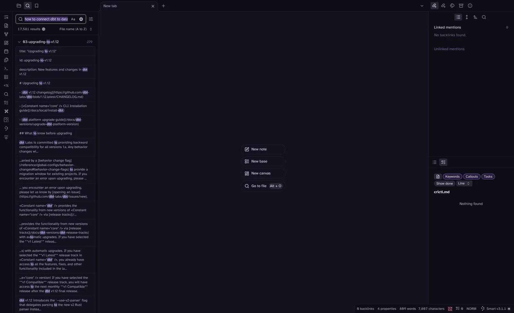 | 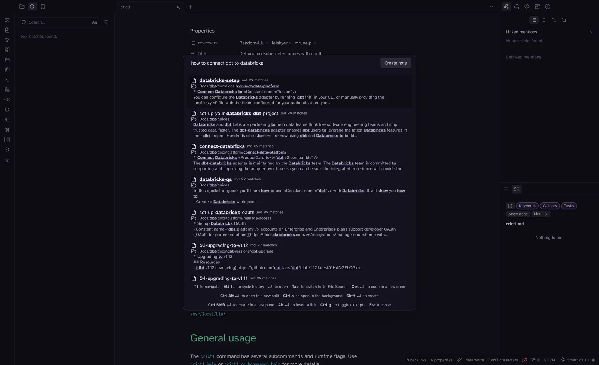 | 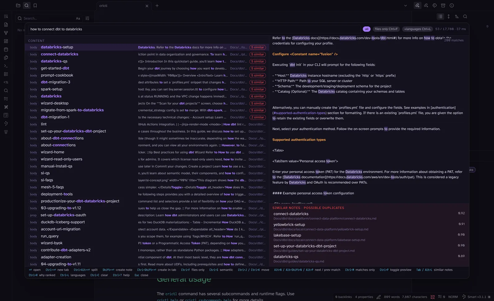 |

### QMD with embeddings (whole vault)

QMD's semantic modes (`vsearch`, `query`) only see files that have been embedded, and
embedding is a separate background job: `qmd embed` runs a local model (embeddinggemma 300M)
over every file once and stores one vector per chunk in its SQLite index. Nothing leaves the
machine; it is the same kind of job Smart Connections ran for this vault. On this 24-core CPU
without a GPU the whole vault took about an hour of wall time in two passes: the first pass
stopped itself after 30 minutes with "LLM session expired before embedding chunk" on the
remaining files, a second `qmd embed` picked those up (5,923 documents, 16,186 chunks, 27 min).
Expect that on a CPU; the job is resumable and only touches changed files afterwards.

The first `query` call also downloads the reranker and query-expansion models (1.9 GB).
Warm, a vector search takes 3–4 s and a hybrid query 3–7 s here; the cost is the models, not
the vault size. Results below are from the fully embedded vault.

| Query | QMD `vsearch` (vectors only) | QMD `query` (expansion + BM25 + vectors + reranker) | Fast Find 10K semantic tier (Smart Connections vectors) |
|---|---|---|---|
| `chocolatey espresso` | *RÖSTMEISTERIN ESPRESSO* 51 %, *Adrianos Espresso* 46 %, *Espresso dark roast* 46 %, *Chocolate* (Wikipedia) 43 % | *RÖSTMEISTERIN ESPRESSO* 98 %, *Espresso dark roast* 43 %, *Colombia* 30 %, *Adrianos Espresso* 27 % | *Ethiopia* 0.65, *Colombia* 0.65, *Adriano Decaf* 0.64 |
| `which coffee has chocolate tasting notes` | *RÖSTMEISTERIN ESPRESSO* 48 %, *Chocolate* 47 %, *Coffee Beans (dataview)* 46 %, *Colombia* 46 % | *Colombia* 100 %, *RÖSTMEISTERIN ESPRESSO* 61 %, *Chocolate* 39 %, *Adriano Decaf* 36 % | *Colombia* 0.72, *Adrianos Alba* 0.69, *Coffee Beans (dataview)* 0.69, *Adriano Decaf* 0.69 |
| `why does my kubernetes pod keep restarting` | *job* ("Running an example Job") 67 %, *init-containers* 66 %, *pod-lifecycle* 66 %, *self-healing* 65 % | *pod-lifecycle* 100 %, *debug-pods* 62 %, *troubleshooting-kubeadm* 58 %, *pod-condition* 51 % | *what-happens-on-restart* 0.78, *self-healing* 0.77, *pod-lifecycle* 0.77, *debug-pods* 0.77 |
| `how to connect dbt to databricks` | *databricks-setup* 74 %, *productionize-your-dbt-databricks-project* 72 %, *sl-qs* 70 % | *databricks-setup* 100 %, *databricks-qs* 63 %, *python-model-configs* 63 %, *connect-databricks* 62 % | (lexical tiers already answer it: *databricks-setup*, *connect-databricks*, *databricks-qs*) |
| `kubernets deploymnet` (two typos) | *setup/_index* 56 %, *deployment* 55 %, *production tools* 53 % | *deployment* ("Use Case") 100 %, *setup/_index* 62 %, *deploy-intro* 61 % | (lexical typo tolerance already answers it) |
| `delta lake` | *glue-setup* 49 %, *migrate-from-spark-to-databricks* 49 %, *delta* (DuckDB) 49 % | *glue-setup* 86 %, *unity_catalog* 61 %, *Data lake* 60 %, *lakehouse_formats* 60 % | (lexical: *databricks-setup* `### Delta Lake`, *delta*, *lakehouse_formats*) |

What this shows:

- **Questions are QMD's strength, and the reranker is what does it.** Vectors alone put the
  Wikipedia *Chocolate* article and an example-Job page near the top; after expansion and
  reranking, *Colombia* (the bean whose notes say chocolate) and *pod-lifecycle* are at 100 %
  with daylight to the rest. Fast Find's Smart Connections tier reaches similar notes for the
  same questions (*Colombia*, *pod-lifecycle*, *debug-pods*) at a fraction of the latency, but
  without the reranker's decisiveness: its top five sit within 0.04 of each other.
- **Vectors also cover typos**, by meaning rather than by letters: `kubernets deploymnet`
  lands on the Deployment page at 100 %.
- **For a plain topic lookup vectors are worse than words.** `delta lake` by vector gives four
  notes at 49 % and the hybrid query puts a Glue connection page first; the three in-Obsidian
  tools agree on *databricks-setup* / *delta* / *lakehouse_formats* in milliseconds.
- **It is a CLI with a model in the loop.** Three to seven seconds a query once warm, longer
  cold, no preview, no opening the note. That is fine for an agent or for "what do I know
  about X", not for a search box you type into.

## Indexing

| Tool | First index of the 17,780 files | Later starts |
|---|---|---|
| Native | none needed (Obsidian's own metadata cache) | instant |
| Omnisearch | minutes on a vault this size, then cached | from cache |
| Fast Find 10K | about 2 s for a full rebuild on a desktop (`Rebuild index` reads every file again; the one run taken while native search was busy indexing reported 6–9 s engine time). The engine indexes in a worker, so a 100k-note vault is still seconds, not minutes | from the IndexedDB cache, only changed files re-read, about 2 s |
| QMD | 37 s for the BM25 index. Embeddings are a separate background job: `qmd embed` ran a local model (embeddinggemma 300M) over every file, about an hour of wall time for the 17,780 files on this 24-core CPU without a GPU, in two passes because the first stopped with "LLM session expired" after 30 minutes. Resumable; afterwards only changed files are embedded | incremental |

## What each does that the others do not

**Native search**
- Zero setup, always there, works on mobile, and shows every match in context under its file.
- The richest operator set: `file:`, `path:`, `content:`, `tag:`, `line:()`, `section:()`,
  `block:()`, `task:`, `/regex/`, `match-case:`, and `["property":value]`.
- No ranking: results sort by name or date, so a common word means scrolling. No typo
  tolerance, no preview beyond the snippet.

**Omnisearch**
- Fast, fuzzy on word prefixes, good highlights, and it can index PDFs and images (with the
  Text Extractor plugin) and search inside the current note.
- No tiers (a body hit can outrank a title), no typos inside words, tags are plain words,
  no properties, no similar notes. Indexing a 10k+ vault takes a while the first time.

**Fast Find 10K**
- Tiers (title → headings → content → partial → semantic), typo tolerance, abbreviation and
  language expansion, live preview with match count and jumps, similar notes, properties,
  bases, canvases, drawings, frecency, create-on-Shift+Enter, vim keys, mobile layout.
- Markdown-family text only: no PDFs, no images, no OCR. Semantic results need Smart
  Connections installed; the plugin never computes embeddings itself.

**QMD**
- A real retrieval pipeline on your own machine: query expansion by a small LLM, BM25 plus
  embeddings, rank fusion, a reranker that reads the candidates. Collections can span folders
  outside the vault, with human-written context per collection. Built for agents: `--json`,
  `--files`, an MCP server.
- Not an Obsidian plugin, so no preview, no opening a note, nothing on mobile. Seconds per
  query once models are warm, longer cold. Keyword mode (`qmd search`) is plain BM25 without
  tiers or typo tolerance; tags and properties are not search syntax. Embedding a large vault
  without a GPU takes about an hour and may need a second run.

## Which search for which vault

> **Under about 1,000 notes.** Native search and the Quick Switcher do the job; Omnisearch is
> a fine upgrade if you want fuzzy matching. Fast Find 10K is still worth it from day one if
> you want the preview, title-first ranking, typo tolerance or the Smart Connections tie-in,
> but you do not *need* it.
>
> **1,000 to 5,000 notes.** Native search's unranked list starts to hurt for common words.
> Omnisearch or Fast Find 10K; both answer in milliseconds here.
>
> **Above 5,000 notes.** This is what Fast Find 10K was built for: tiers and typo tolerance
> matter because you cannot scroll 900 hits, the index comes from cache in seconds, and the
> similar-notes panel catches the duplicates a vault that size accumulates.
>
> **Asking questions rather than finding notes** ("what do I know about motivation decay?"),
> or wiring your notes into an AI agent: QMD, next to whichever in-Obsidian search you use.
> Inside Obsidian, Fast Find 10K's semantic tier with Smart Connections covers the lighter
> version of that.
