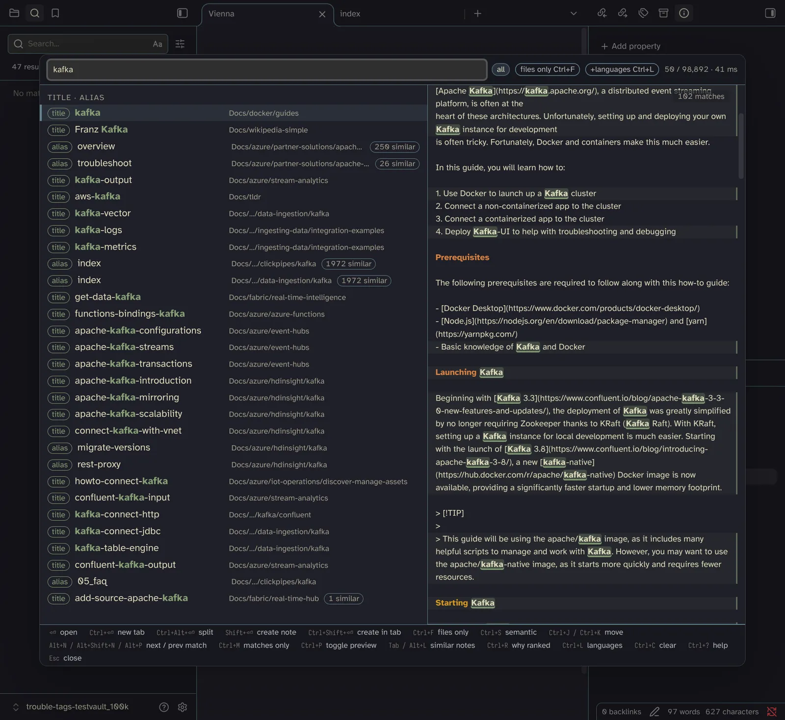
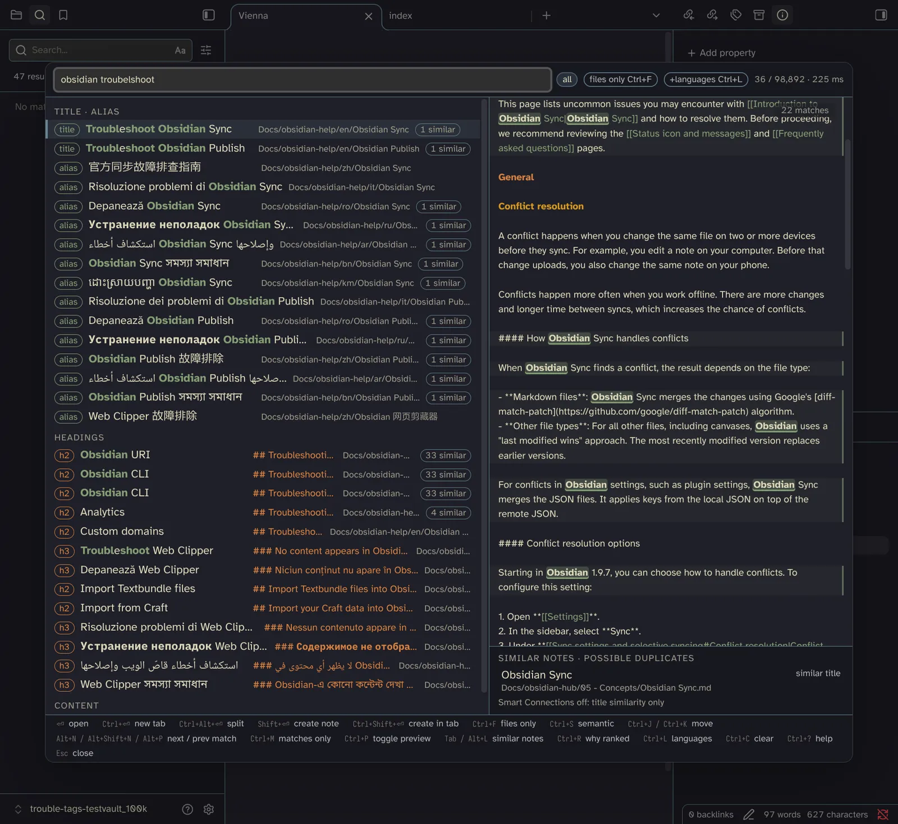
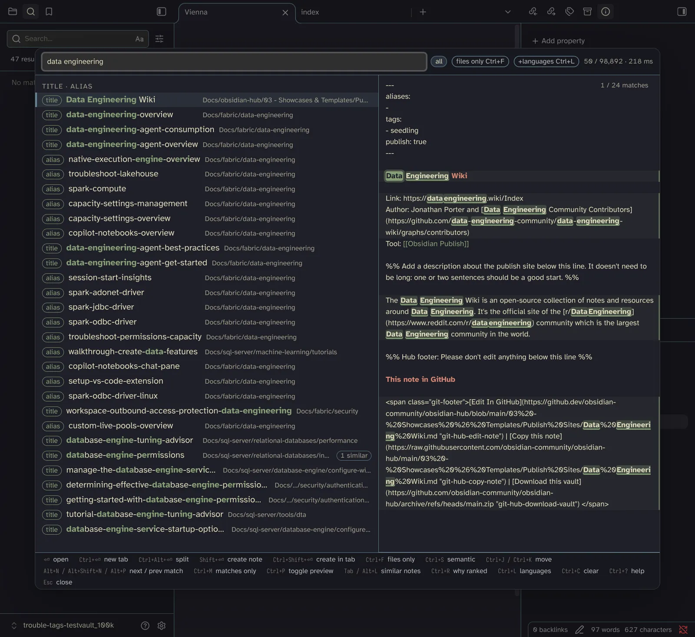
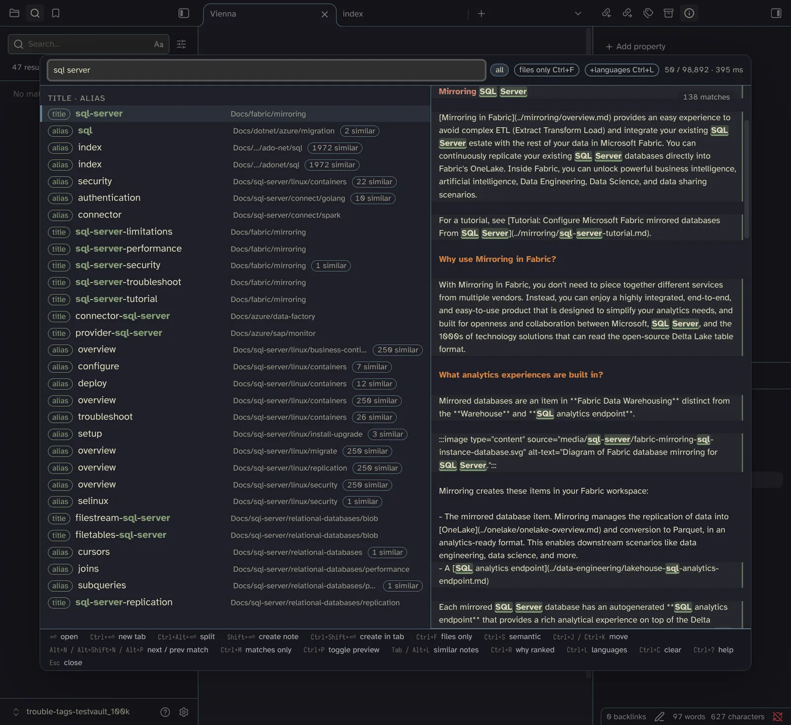

# Performance notes

## 100k notes

Measured 2026-11-03 on `trouble-tags-testvault_100k`: **98,892 indexed notes, 584 MB of markdown**
(the test vault plus documentation from MDN, Azure, SQL Server, .NET, GitHub, Fabric, PowerShell,
Docker, ClickHouse, Obsidian Help and Hub, Neovim, and 6,000 Simple English Wikipedia articles).
Obsidian 1.14.4 desktop with only Fast Find 10K 0.2.6 and Vimrc Support enabled, no Smart
Connections vectors. Same machine as below (AMD Ryzen AI 9 HX 370, `powersave` governor). For
comparison, the 17,783-note / 82 MB `trouble-tags-testvault` was open in the same Obsidian
instance.

### Start and memory, in Obsidian

| | 98,892 notes / 584 MB |
|---|---|
| Plugin reload → searchable (first batch in the engine) | 0.57 s |
| Plugin reload → fully indexed (warm, from the cache) | 37.9 s |
| Worker memory (`stats.wasmBytes`) | 2.32 GB |

The finder answers 0.6 s after start; until the index is done, queries search the notes ingested
so far and the status line shows `indexing N / M`.

### Queries in Obsidian

Engine time (`elapsedUs` of `engine.search(q, 'all', 30, false)`), median of 7 runs each, both
vaults measured back to back. Wall clock around the worker round trip was at most 1 ms more.

| Query | 17,783 notes | 98,892 notes |
|---|---|---|
| `kafka` | 6.9 ms | 19.1 ms |
| `ai` | 5.8 ms | 41.9 ms |
| `path:resources` | 5.8 ms | 41.7 ms |
| `git` | 19.4 ms | 55.2 ms |
| `duckdb` | 9.1 ms | 67.2 ms |
| `zettelkasten` | 9.5 ms | 93.4 ms |
| `kubernetes` | 13.8 ms | 148.6 ms |
| `troubleshoot` | 11.6 ms | 154.0 ms |
| `dagster` | 15.0 ms | 173.9 ms |
| `linux kernel` | 16.1 ms | 182.8 ms |
| `data engineering` | 17.1 ms | 219.2 ms |
| `obsidian troubelshoot` (typo) | 24.8 ms | 221.4 ms |
| `data engineer ai` | 18.5 ms | 229.4 ms |
| `select` | 27.1 ms | 354.1 ms |
| `sql server` | 19.8 ms | 401.2 ms |

Obsidian's native search on the same 100k vault, timed until it stopped working (the search
view's `dom.working` flag; it streams results, so the first ones appear earlier):

| Query | Native search | Native results | Fast Find |
|---|---|---|---|
| `obsidian troubelshoot` | 2.0 s | 47 | 221 ms |
| `kafka` | 14.0 s | 7,803 | 19 ms |
| `data engineering` | 34.9 s | 44,394 | 219 ms |
| `sql server` | 57.4 s | 620,690 | 401 ms |

### Screenshots

The status line at the top right shows hits / indexed notes · engine time; the vault name is at
the bottom left.

`kafka`, 41 ms (first run in the modal; repeated runs take 19 ms):



`obsidian troubelshoot` (typo), 225 ms:



`data engineering`, 218 ms:



`sql server`, the slowest query measured, 395 ms:



### Native CLI (`ff10k`, pinned with `taskset -c 2`)

| | 17,783 notes / 82 MB | 98,892 notes / 584 MB |
|---|---|---|
| `ff10k index` (read + index + CLI ghost scan) | 7.85 s, RSS 790.5 MB | 44.71 s, RSS 3,181.7 MB |
| read files | 136 ms | 982 ms |
| upsert (engine only) | 4,858 ms (16.9 MB/s) | 30,230 ms (19.3 MB/s) |
| extract / derive / insert / keys | 974 / 1,945 / 1,858 / 49 ms | 6,150 / 13,803 / 9,674 / 435 ms |
| first search | 117 ms | 601 ms |
| engine heap | 627.5 MB | 2,585.7 MB |

| Query (`ff10k bench`) | 17,783 notes p50 / p95 | 98,892 notes p50 / p95 |
|---|---|---|
| `ai` | 3.4 / 6.0 ms | 43.2 / 50.4 ms |
| `data engineering` | 32.1 / 34.2 ms | 187.4 / 193.9 ms |
| `data engineer ai` | 24.1 / 25.7 ms | 171.9 / 182.0 ms |
| `obsidian troubelshoot` | 38.1 / 39.4 ms | 129.6 / 136.5 ms |
| `path:resources` | 1.8 / 2.7 ms | 20.0 / 23.2 ms |

### What it means

- **It works at 100k.** Every query returned its ranked list in under half a second, most in
  150–230 ms, against 14–57 s for Obsidian's own search on the same vault. Every keystroke is a
  query and a superseded one is dropped, so typing does not queue up.
- **Cost grows with the text.** 7× the markdown (82 → 584 MB) makes queries about 3–20× slower.
  The slowest are common words that hit a large share of the vault (`sql server`, `select`):
  every candidate is scored before the list is cut.
- **Indexing and memory grow linearly.** Ingest runs at the same ~19 MB/s, so 584 MB takes about
  30 s in the engine and 38 s in Obsidian, in the worker, searchable from 0.6 s on. The worker
  holds 2.3 GB, far above the 150 MB budget set for 10k notes: the index keeps postings plus the
  raw text for excerpts and the preview, so it grows with the markdown.
- **Obsidian itself is the bottleneck at this size.** Its metadata cache took many minutes on
  first open, and renaming a note with link updates (`fileManager.renameFile`) took 44.6 s,
  against 0.26 s for a plain `vault.rename`; creating a note took 0.3 s. Fast Find's part of
  either is the same coalesced 500 ms update as on a small vault.

Method: the evals in `docs/dev-checklist.md` against the second vault
(`obsidian vault=trouble-tags-testvault_100k eval code=…`), Obsidian's search timed through
`openGlobalSearch(q)` and `dom.working`, screenshots with `dev:screenshot` and
`magick -resize 1600x -quality 80`.

## The 9k-note test vault

Budgets from spec §14 (10k notes, 30 MB, desktop). Measured 2026-10-26 on the test vault
(`trouble-tags-testvault`: 9,385 indexed notes, 27 MB of markdown) on an AMD Ryzen AI 9 HX 370
(4 Zen 5 + 8 Zen 5c cores, `powersave` governor). Native runs are pinned to a Zen 5 core
(`taskset -c 2`); unpinned runs land on either core type and vary by up to 2×. "Before" is the
state at the start of Task 22 (commit `12e6e95`), rebuilt and measured back to back with "after".

## Against the budgets

| Metric | Budget | Before | After | Status |
|---|---|---|---|---|
| Warm start → searchable (first 500 notes in the engine) | < 1 s | ~309 ms | ~300 ms (first batch 60–100 ms in wasm) | met |
| Warm start → done (Obsidian, 3 plugin reloads) | < 1 s (owner: a few seconds is fine) | 3,567–3,593 ms | 1,215–1,419 ms | missed, accepted |
| Cold full index (Rebuild index command, files in the OS cache) | < 30 s | 3,667 ms | 1,344 ms | met |
| Rebuild index command, end to end | — | 7,619 ms | 1,781 ms | — |
| Query engine p95, native release (`ff10k bench`, 5 queries) | < 10 ms | 2.3 / 13.0 / 16.5 / 7.6 / 1.3 ms | 1.8 / 7.1 / 8.8 / 2.4 / 1.4 ms | met |
| Query engine, wasm (node, no vectors), p50 | ≤ 1.5× native | — | 0.8 / 6.7 / 5.9 / 4.4 / 1.2 ms (0.7× / 1.2× / 1.0× / 2.0× / 1.4×) | met except `obsidian troubelshoot` (2.0×, 4.4 ms) |
| Query engine in Obsidian (worker, with Smart Connections vectors), repeated query | < 10 ms | 2–18 ms | 7.5–15.7 ms | `data engineer ai` / `data engineering` ≈ 15 ms: missed |
| First query after reload, Obsidian | — | 59–68 ms | 27 ms | — |
| Keystroke → painted (typing `data engineerin` at 60 ms/char, `logTimings`) | < 30 ms | engine 6.1–15.3 ms + render 2.4–5.2 ms | engine 3.6–18.1 ms (median ≈ 10) + render 2.8–5.3 ms | met |
| Worker memory (wasm linear memory, `stats.wasmBytes`) | < 150 MB | 181.5 MB | 164 MB (node, no vectors/ghosts: 179.5 → 135 MB) | missed |
| `main.js` size (wasm + worker embedded) | < 3 MB | 1,418,836 B | 1,427,984 B | met |
| Semantic query (embed + scan) | < 100 ms | 7 + 1 ms (Task 20) | unchanged | met |

Queries, in order: `ai`, `data engineering`, `data engineer ai`, `obsidian troubelshoot`,
`path:resources`.

What is left:

- **Warm start → done ≈ 1.2–1.4 s.** Engine ingest is ~0.9 s native and ~1.0–1.1 s in wasm
  (extract 20 %, tokenize 40 %, posting inserts 35 %, keys 4 %), plus the IndexedDB cursor (~180 ms,
  overlapped). The worker batch format is not the cost: `JSON.stringify` of all batches is 60 ms and
  per-doc `upsert` calls instead of `upsert_batch` measured the same (1,084 vs 1,099 ms). Per the
  owner's guidance (searchable within ~300 ms, done within a few seconds is acceptable) no more
  index-time work was done.
- **Worker memory 164 MB in Obsidian.** Index (postings, dictionaries, docs, raw text) ≈ 135 MB,
  Smart Connections vectors 8,383 × 384 ≈ 15 MB, 5,000 ghosts ≈ 4 MB, plus the allocator's
  high-water mark (wasm memory never shrinks). Next candidates, not done: one allocation per
  posting list instead of three (about 170k small lists), dropping `Doc::links`/`tags` after
  indexing (only needed to unindex, which re-extracts anyway).
- **Engine time in Obsidian is ~2× the node numbers** for the same wasm (7.3 vs 15.7 ms for a
  repeated `data engineer ai`). The worker's `elapsedUs` also includes JSON (de)serialization and
  the UTF-16 range rewrite; the Electron worker thread is also not pinned to a fast core.

## Result identity

Every optimization below was checked to return identical results: a harness (`snap`, outside the
repo) builds the engine from the test vault with the old and the new core and prints the top 50
hits of 48 queries in both modes (all, files only) with `debug: true`, as JSON (path, title, tier,
score, badge, title ranges, heading, excerpt, line, similar count, per-term field/kind/quality and
score components). Queries: `ai writing`, `should i change`, `"data engineering"`, `ai`, `a`, `d`,
`da`, `data`, `data engineering`, `data engineer ai`, `ai data engineering`,
`obsidian troubelshoot`, `obsidian trouble`, `path:resources`, `rust data eng`,
`mlops data engineering`, `"data lake"`, `tag:ai`, `#obsidian`, `-ai data`, `kafka`, `dbt`,
`duckdb motherduck`, `spati`, `semantic layer`, `bi tools`, `x`, `the`, `zettelkasten`, `sql`,
`python pandas`, `airflow dagster`, `open source`, `data modeling`, `dimensional`, `streaming`,
`lakehouse iceberg`, `café`, `日本`, `foo_bar`, `DataEngineering`, `data-engineering`, `10k`, `ml`,
`llm agents`, `vector database`, `graph`, `k`; plus `similar()` for two notes and `doc_text` lengths.

Final diff, start-of-task core (`12e6e95`) vs `HEAD`: **no differences** (3,788 lines, byte for
byte). The golden suite (`cargo test -p ff10k-core --features golden --test golden`) passes after
every step.

## Optimizations, before → after

Native numbers are release builds on the test vault; each row was measured back to back with the
build before it.

| Commit | Change | Measured |
|---|---|---|
| `92f38b6` | `ff10k profile`: per-phase ingest timing | baseline split: read 85 ms, upsert 5,071 ms = extract 1,885 + derive (tokenize) 1,964 + insert 1,078 + keys 128 (unpinned, slow-core run); first search 73 ms; RSS 275 MB |
| `7622be9` | `normalize` ASCII fast path (no NFKC/NFD/NFC on ASCII), allocation-free tokenizer (`for_each_token`, reused buffers), word count without materializing tokens | upsert 5,071 → 3,086 ms (same conditions); extract 1,885 → 840, derive 1,964 → 973 |
| `cf21c28` | term dictionary: `FxHashMap` term → slot plus a `BTreeMap` over the same `Rc<str>` keys for prefix scans; body tokenized once (index sets `word_count`) | upsert 1,314 → 815 ms (insert 515 → 268, extract 351 → 172) |
| `b737d96`, `f882144` | `ff10k profile` reports live engine heap (counting allocator, idle unless profiling) | engine heap 239 MB: body postings 109 MB (40-byte `Posting` with inline `SmallVec`), records 77 MB, other fields 24 MB, ghosts 10 MB |
| `f388aa0` | column-wise posting lists (doc ids, position ends, positions) | engine heap 239 → 179 MB, RSS 276 → 218 MB; ingest unchanged |
| `355075a` | `Engine::clear` (wasm `clear`, worker `clear`, `EngineClient.clear`) used by `Indexer.rebuild` | removing 9,385 docs one by one: 1,656 ms (wasm) → O(1); Rebuild index command 7,619 → 1,781 ms in Obsidian |
| `4a340d2` | `Engine::warm_up` (field strings + backlinks of index and ghosts), run by the worker 100 ms after the last mutation | first query after reload 59–68 → 27 ms in Obsidian (the rest is the first semantic similar-count scans) |
| `6d3b710` | multi-unit queries: Body hits built only for docs that can get a tier | `data engineering` p50 7.0 → 6.5 ms (p95 9.0 → 7.6); `data engineer ai` p50 8.7 → 7.8 ms (p95 12.0 → 8.8) |
| `65f3d38` | wasm `set_vectors` takes an owned `Vec<f32>`; worker `stats` reports `wasmBytes` | one 13 MB copy less while loading vectors; Obsidian worker memory measurable (181.5 MB) |
| `d62bc9e` | index keeps only the raw text; body lines rebuilt on demand (`body_line`), excerpts from `body_window` (line token positions) | engine heap 179 → 160 MB; wasm memory (node) 154 → 135 MB; Obsidian 181.5 → 161 MB; `obsidian troubelshoot` p50 3.4 → 2.3 ms |
| `dbb2f0f` | `Vectors::new` keeps the caller's buffer | wasm memory with ghosts + vectors (node) 166.8 → 155.4 MB |
| `950b789` | `similar_count` memoized per (path, semantic) until the next index/vector mutation | wasm with vectors, repeated query: `data engineer ai` p50 19.0 → 7.3 ms, `ai` 11.8 → 0.7 ms |

Not changed, measured: worker batch transfer (JSON vs per-doc calls, see above); tokenizer
byte-level ASCII paths for word splitting and camelCase (≤ 4 %, reverted); interning terms to
dictionary slots while deriving (no gain, +5 MB, reverted).

## Native, `ff10k index` / `ff10k bench` / `ff10k profile` (pinned)

| | Before | After |
|---|---|---|
| `ff10k index` (read + index + CLI ghost scan) | 4.02 s, RSS 271.9 MB | 1.30 s, RSS 191.6 MB |
| upsert (engine only) | — | 874 ms (29.6 MB/s): extract 171, derive 347, insert 316, keys 31 |
| engine heap | 239 MB | 160 MB |

| Query (200 runs) | Before p50 / p95 | After p50 / p95 |
|---|---|---|
| `ai` | 1.95 / 2.25 ms | 1.21 / 1.81 ms |
| `data engineering` | 9.74 / 13.02 ms | 5.61 / 7.08 ms |
| `data engineer ai` | 13.73 / 16.47 ms | 5.84 / 8.82 ms |
| `obsidian troubelshoot` | 6.44 / 7.63 ms | 2.21 / 2.35 ms |
| `path:resources` | 1.00 / 1.34 ms | 0.87 / 1.39 ms |

## Wasm in node (same `.wasm` as the plugin, no vectors or ghosts)

`node bench.mjs <pkg> <vault>`: reads the vault, `upsert_batch` in batches of 500 as the worker
does, then 100 runs per query.

| | Before | After |
|---|---|---|
| ingest (`upsert_batch`, 9,385 notes) | 3,740 ms | 1,057 ms |
| first batch searchable | 221 ms | 96 ms |
| wasm memory after ingest | 179.5 MB | 135.0 MB |
| `ai` p50 | 2.17 ms | 0.81 ms |
| `data engineering` p50 | 7.64 ms | 6.72 ms |
| `data engineer ai` p50 | 12.11 ms | 5.92 ms |
| `obsidian troubelshoot` p50 | 9.42 ms | 4.45 ms |
| `path:resources` p50 | 1.29 ms | 1.20 ms |

## Criterion (`cargo bench -p ff10k-core`, pinned)

10k notes cloned from `fixtures/vault` (texts cut to 3,000 bytes; the fixture notes are short, so
the corpus is 3 MB); vector scan 10k × 384. Medians:

| Bench | Before | After |
|---|---|---|
| index 10k notes (3 MB) | 390.5 ms | 122.3 ms |
| query `ai` | 1.81 ms | 1.71 ms |
| query `data engineering` | 6.10 ms | 5.13 ms |
| query `data engineer ai` | 7.93 ms | 6.98 ms |
| query `obsidian troubelshoot` (fuzzy) | 3.02 ms | 2.39 ms |
| vector scan 10k × 384 | 0.568 ms | 0.559 ms |

## How to measure

```sh
taskset -c 2 target/release/ff10k profile <vault>   # ingest split + engine heap
taskset -c 2 target/release/ff10k bench <vault>     # query p50/p95
taskset -c 2 cargo bench -p ff10k-core              # criterion
```

In Obsidian (see docs/dev-checklist.md): the `[ff10k] indexed … in N ms` console line after a
plugin reload; worker memory through the worker's `stats` reply:

```bash
o eval code="const w=app.plugins.plugins['fast-find'].engine.worker; w.addEventListener('message', ev=>{ if(ev.data.t==='stats' && ev.data.id===999999) window.__mem=ev.data }); w.postMessage({t:'stats', id:999999}); 'sent'"
o eval code="JSON.stringify(window.__mem)"   # → {…,"docs":9385,"wasmBytes":164036608}
```
