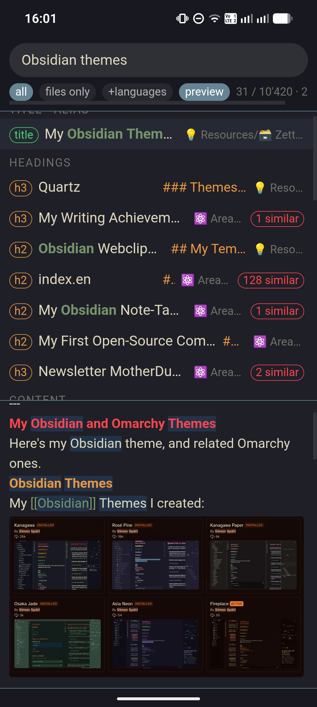
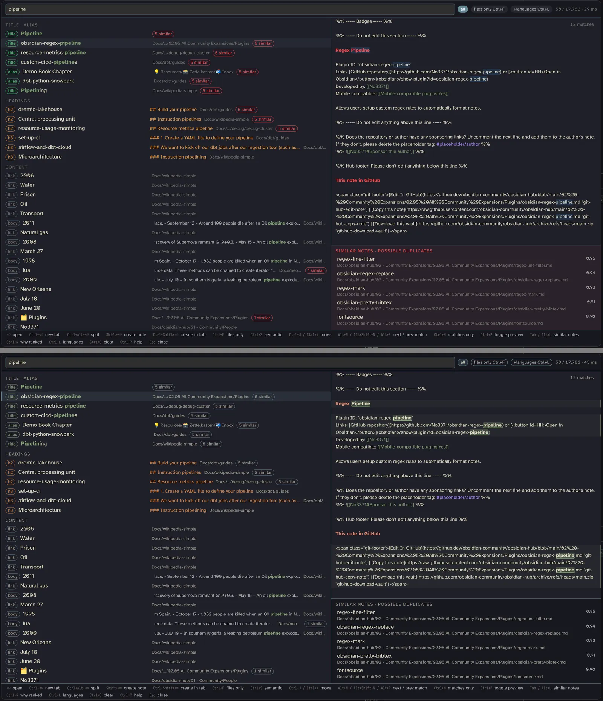
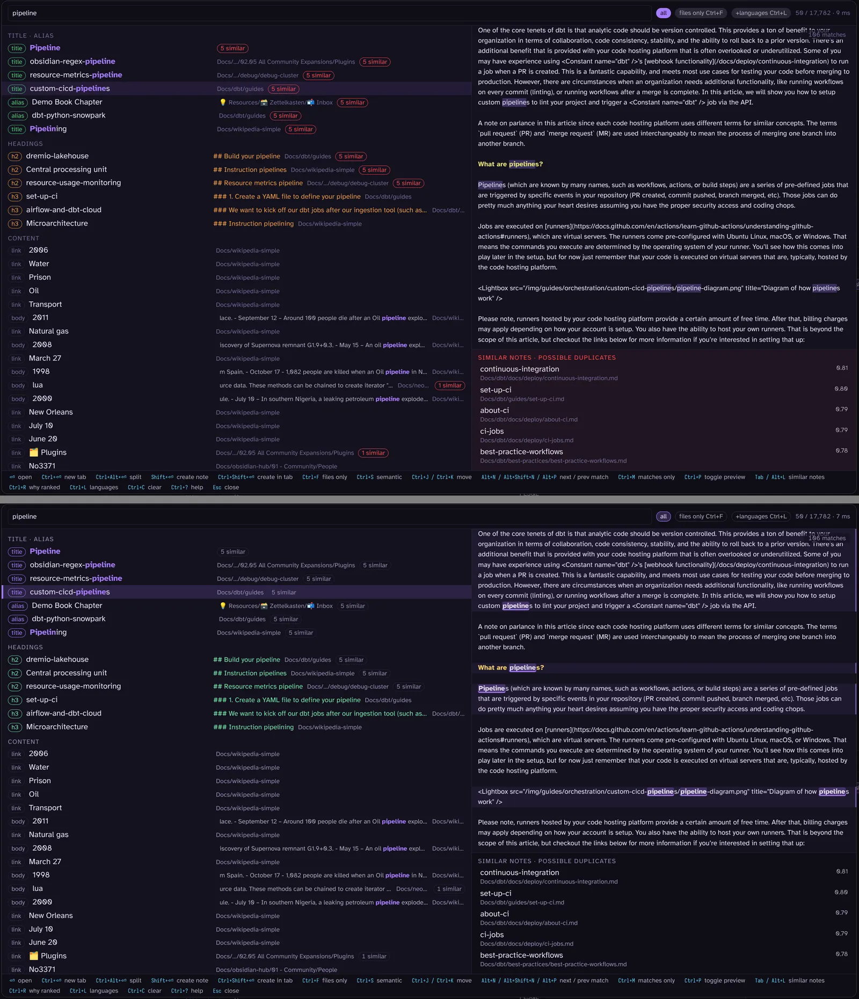
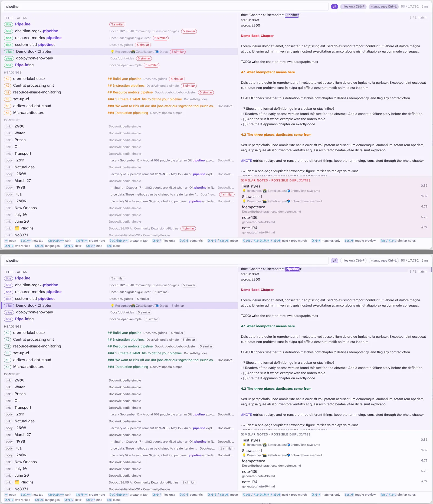
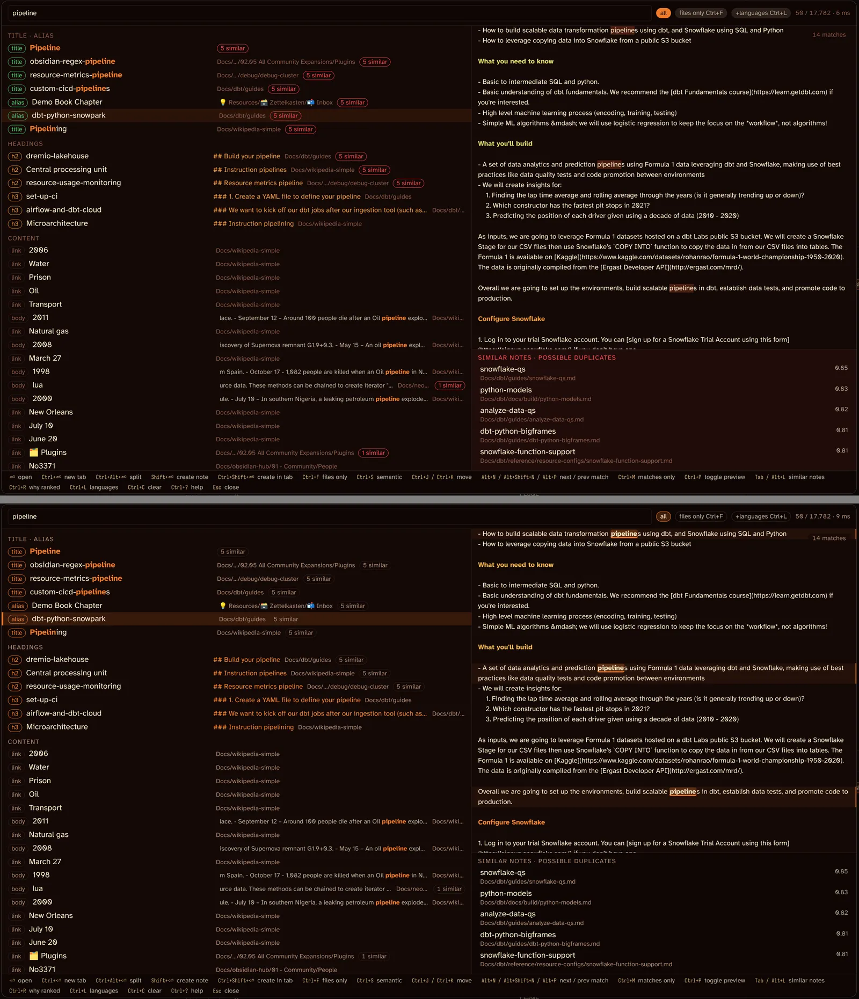
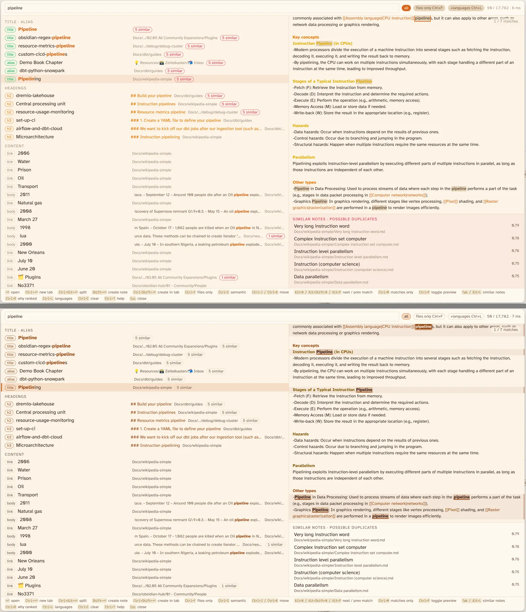
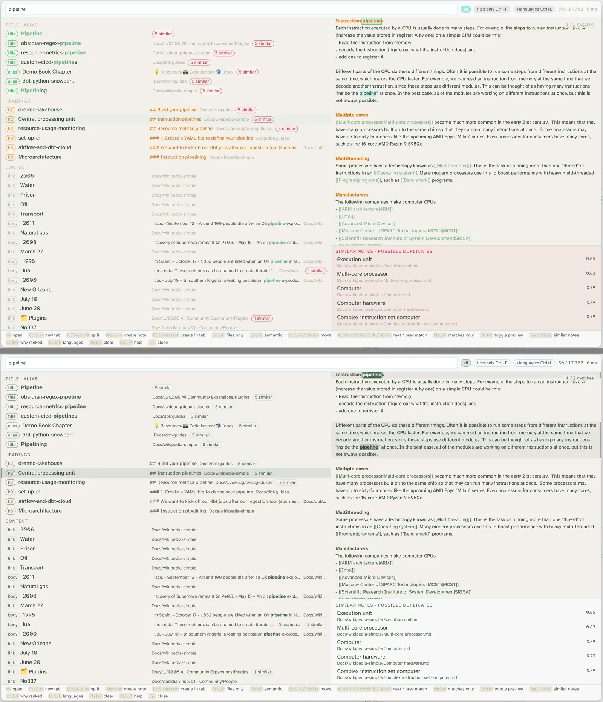

# Showcase

What the features look like, one screenshot each. The README keeps the text; this page keeps the pictures.
Images are the ones posted on the GitHub issues that asked for the feature, so they stay out of the repository.

## Matches in the preview

The preview header counts the highlighted matches in the note. `Alt+N` / `Alt+P` jump between them, `Ctrl+M` shows only the lines around each match, with line numbers. Asked in [#3](https://github.com/ssp-data/obsidian-fast-find-10k/issues/3) and on Reddit.

## Properties

Every frontmatter key and value is searchable. `[key]` lists the notes that have the property, `[key:value]` the ones with that value. Asked in [#4](https://github.com/ssp-data/obsidian-fast-find-10k/issues/4) and on Reddit.

## Canvases and Bases

`.canvas` and `.base` files are indexed with the file name as title; a canvas is previewed as its cards and labels. `type:canvas` / `type:base` keep one kind, the small marker on the row shows which. Asked in [#1](https://github.com/ssp-data/obsidian-fast-find-10k/issues/1).

## Excalidraw drawings

A drawing contributes its text elements; `type:drawing` keeps only drawings. Asked in [#2](https://github.com/ssp-data/obsidian-fast-find-10k/issues/2).

## Ribbon icon

One click in the left ribbon (the drawer on mobile) opens the search; Settings → Behaviour turns it off. Asked in [#7](https://github.com/ssp-data/obsidian-fast-find-10k/issues/7) and on Reddit.

## Mobile

One column, pills instead of key hints, a ✕ to close (swipe left works too), two taps to open when the preview is on. The close button came from [#8](https://github.com/ssp-data/obsidian-fast-find-10k/issues/8).

## Theme colours (0.2.4)

The modal takes its colours from the theme and, when it opens, blends each one toward the theme's text colour only as far as it needs to read at 4.5:1. The selected row gets a bar and a tint, the `N similar` pills go quiet, matches in the preview are bold and underlined with a band across their line. Each image shows 0.2.3 above and 0.2.4 below, on the test vault with `pipeline` typed.

## Why ranked

`Ctrl+R` shows the tier, the matched fields and every score part of each row.

